# Лабораторна робота №9. Побудова системи реєстрації та входу користувачів. Модуль Flask-Login

**Студент:** Сосновець Дмитро Сергійович, ІПЗ-33
**Гілка:** [`lab9`](https://github.com/dmytrososnovets24-glitch/flask-app-lab/tree/lab9) (створена з `lab8`)

## Частина 1. Реєстрація користувачів

### 1. Flask-Bcrypt
- `pip install flask-bcrypt` (у `requirements.txt` додано `Flask-Bcrypt==1.0.1`).
- `app/__init__.py`: об'єкт `bcrypt = Bcrypt()` і `bcrypt.init_app(app)` у фабриці `create_app()`.
- У моделі `User` з'явилися методи `hash_password()` (замінює пароль його bcrypt-хешем) і `check_password(password)` (порівнює пароль із хешем). Для записів, у яких у БД лежить не хеш, `check_password` повертає `False`, а не падає з помилкою.

### 2. Користувач із хешованим паролем у `flask shell`
- Створено третього користувача `sosnovets` і збережено його пароль як `bcrypt.generate_password_hash(...).decode("utf-8")`.
- `generate_password_hash` повертає `bytes`, тому для поля `String(60)` хеш декодується в рядок.
- `bcrypt.check_password_hash(users[2].password, "...")` повертає `True` для правильного пароля і `False` для неправильного. У перших двох користувачів (з лабораторної №8) паролі збережені відкритим текстом — так само, як у таблиці в завданні.

### 3. Сторінка реєстрації (`/users/register`)
- `app/users/forms.py`, клас `RegistrationForm`:
  - `username` — обов'язкове, від 4 до 14 символів, `Regexp`: починається з латинської літери, далі літери, цифри, крапки або підкреслення;
  - `email` — обов'язкове, валідатор `Email()`; пробіли обрізаються, адреса зберігається в нижньому регістрі;
  - `password` — обов'язкове, щонайменше 6 символів;
  - `confirm_password` — `EqualTo('password')`;
  - `validate_username` і `validate_email` перевіряють унікальність у БД (запити SQLAlchemy 2.0).
- Маршрут хешує пароль перед збереженням (`user.hash_password()`), показує flash-повідомлення і перенаправляє на сторінку входу.

```python
@users_bp.route('/register', methods=['GET', 'POST'])
def register():
    if current_user.is_authenticated:
        return redirect(url_for('users.account'))

    form = RegistrationForm()
    if form.validate_on_submit():
        user = User(username=form.username.data, email=form.email.data, password=form.password.data)
        user.hash_password()
        db.session.add(user)
        db.session.commit()
        flash(f'Обліковий запис для {user.username} створено! Тепер можна увійти.', 'success')
        return redirect(url_for('users.login'))
    return render_template('users/register.html', form=form, title='Реєстрація')
```

### 4. Вхід на сайт (`/users/login`)
- Наявний вхід, що порівнював логін і пароль з константами `AUTH_USERNAME` / `AUTH_PASSWORD`, замінено перевіркою по БД: `LoginForm` (`email`, `password`, `remember`), користувач шукається за email, пароль перевіряється порівнянням хешів (`user.check_password`).
- У частині 1 після успішного входу дані користувача записувались у сесію (`session['username'] = user.username` тощо) і виконувалось перенаправлення на нову сторінку `account` (`/users/account`, шаблон `account.html`). У частині 2 сесію замінив `login_user`.

### 5. Список користувачів (`/users/`)
- Таблиця з `Id`, ім'ям, email і кількістю постів; у заголовку — кількість користувачів. Якщо користувачів немає, виводиться «Зареєстрованих користувачів поки немає». Пости користувачів завантажуються через `selectinload(User.posts)`, тож немає N+1.

## Частина 2. Flask-Login

### 6. Авторизація і захист сторінок
- `pip install flask-login` (`Flask-Login==0.6.3`). В `app/__init__.py`:
  ```python
  login_manager = LoginManager()
  ...
  login_manager.init_app(app)
  login_manager.login_view = 'users.login'
  login_manager.login_message = 'Будь ласка, увійдіть, щоб отримати доступ до цієї сторінки.'
  login_manager.login_message_category = 'warning'
  ```
- `app/users/models.py`: функція `user_loader` (`db.session.get(User, int(user_id))`) і `class User(db.Model, UserMixin)`.
- Після перевірки пароля викликається `login_user(user, remember=form.remember.data)`: id користувача записується в сесію рядком, а позначка «Запам'ятати мене» додає кукі `remember_token`. Якщо на сторінку входу перенаправив `@login_required`, після входу користувач повертається на потрібну сторінку (`?next=`), але лише в межах сайту.
- `@login_required` захищає `account`, список користувачів і сторінку кукі та теми з лабораторної №4. Неавторизованого користувача перенаправляє на вхід із попередженням.
- `account` отримує `current_user`; вихід — `logout_user()` з повідомленням «Ви вийшли з системи.».

### 7. Додаткова функціональність
- Авторизований користувач, який відкриває `/users/register` або `/users/login`, потрапляє на `account`.
- Меню: для гостя — «Вхід» і «Реєстрація», для авторизованого — «Користувачі», «Профіль (ім'я)» і «Вихід».
  ```html
  
      ... Користувачі, Профіль ({{ current_user.username }}), Вихід
  
      ... Вхід, Реєстрація
  
  ```
- Список усіх користувачів доступний лише авторизованим (`@login_required`).
- У формі нового поста автором за замовчуванням вибрано поточного користувача.

## Частина 3. Тестування

### 8. Тести (`tests/test_auth.py`, 37 тестів)
- **Views Tests**: сторінки реєстрації та входу відкриваються (код 200, потрібні поля), меню гостя.
- **Реєстрація**: користувач зберігається в БД з bcrypt-хешем замість пароля; повідомлення про успіх; відмова для зайнятих email і username, некоректного email, короткого або невідповідного шаблону імені, короткого пароля, різних паролів, порожніх полів; email нормалізується.
- **Вхід і вихід**: успішний вхід (`_user_id` у сесії, `current_user`), дані на сторінці `account`, меню авторизованого користувача, неправильний пароль, невідомий email, користувач з паролем без хешу, кукі `remember_token`, перехід за `?next=` лише в межах сайту, вихід.
- **Захищені сторінки**: перенаправлення гостя з повідомленням, список користувачів і повідомлення для порожнього списку, автор нового поста за замовчуванням.
- **CSRF**: токен у формах, POST без токена відхиляється.
- Тести лабораторної №4 (`tests/test_auth_cookies.py`) переписано на вхід користувача з БД.
- Усього 210 тестів, усі проходять. Повний вивід: [docs/test_results.txt](docs/test_results.txt).

## Скриншоти

### Частина 1, пункт 2. Користувач із хешованим паролем у `flask shell`
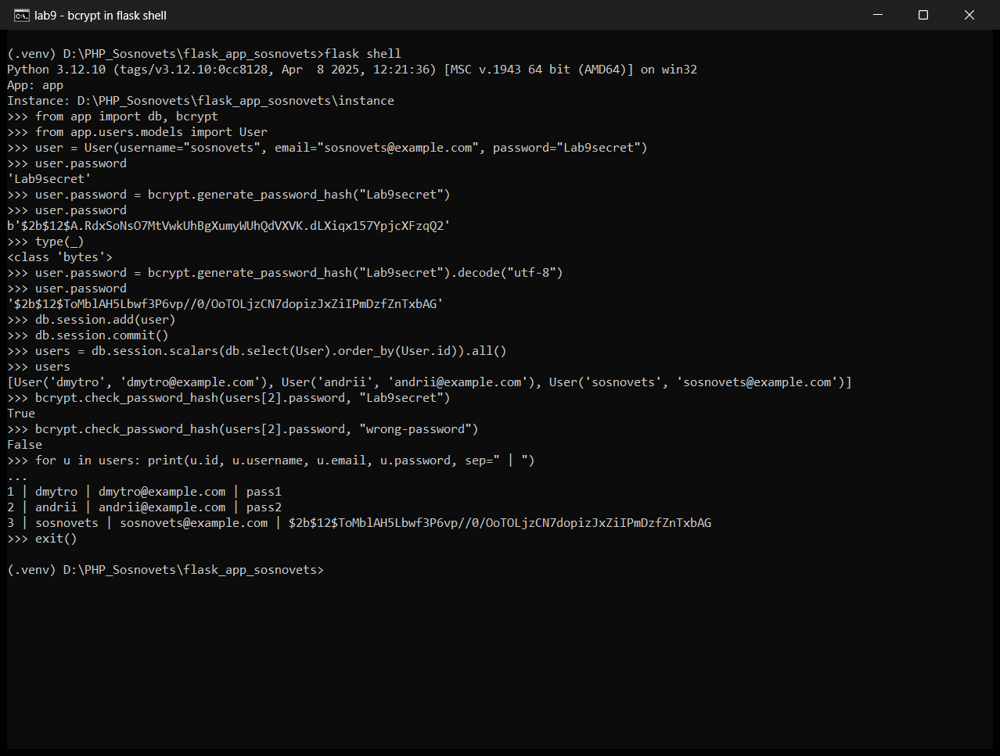

### Пункт 3. Реєстрація: такий користувач уже існує в БД
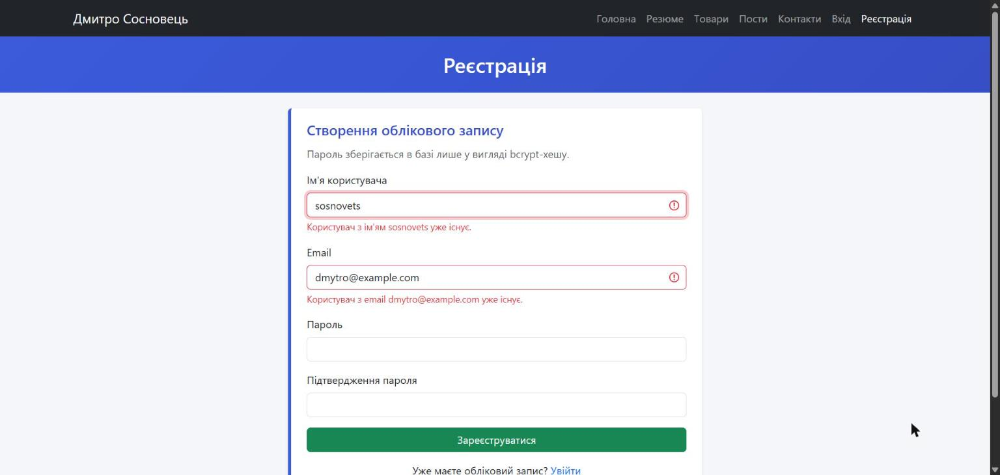

**Реєстрація: помилки валідації (ім'я, email, довжина пароля, підтвердження)**

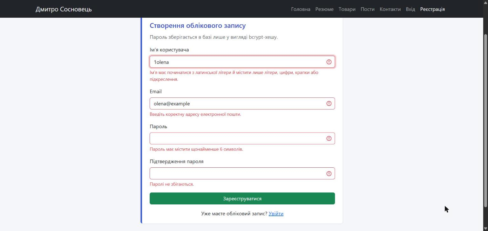

**Успішна реєстрація: перенаправлення на вхід із повідомленням**

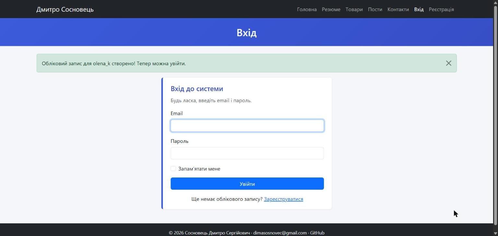

**Новий користувач збережений у БД з bcrypt-хешем, пароль перевіряється**

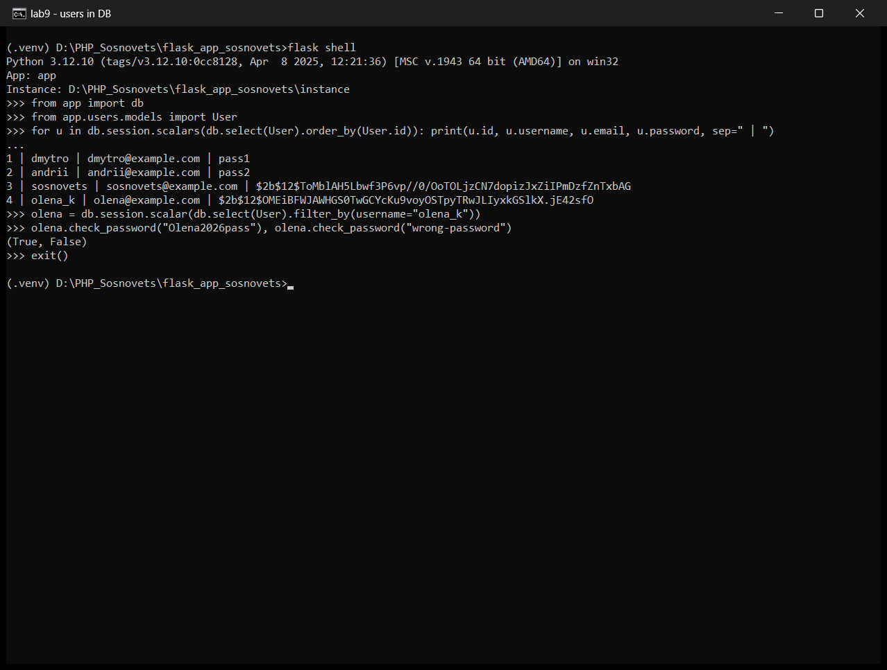

### Пункт 4. Вхід
**Неправильний пароль**

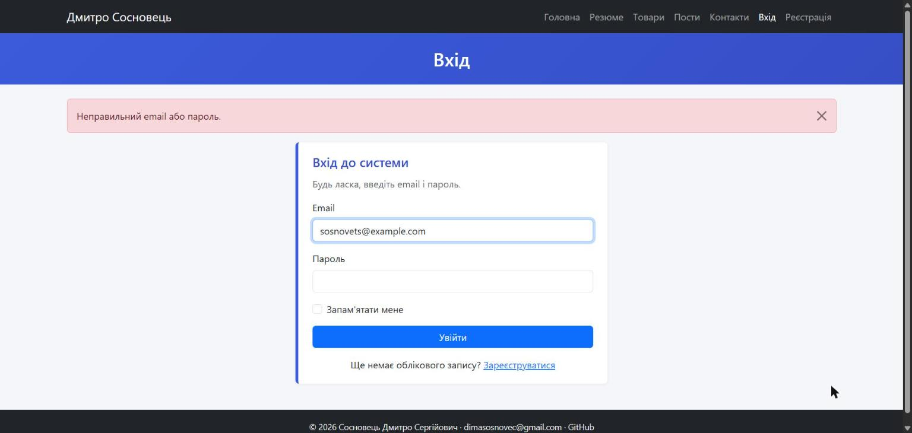

**Успішний вхід: сторінка `account`, у меню «Профіль» і «Вихід»**

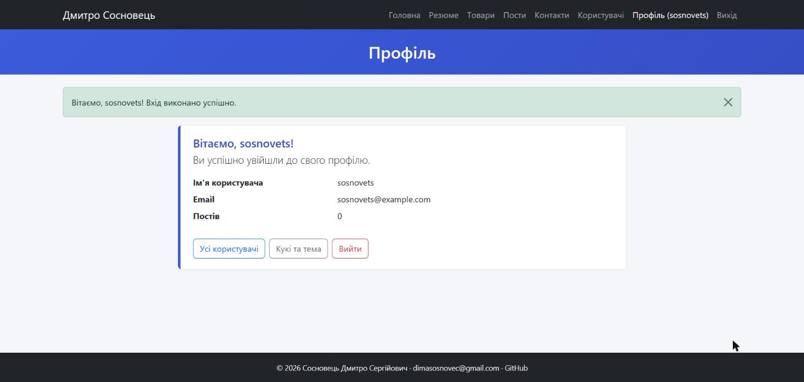

### Пункт 5. Список користувачів і їх кількість (лише для авторизованих)
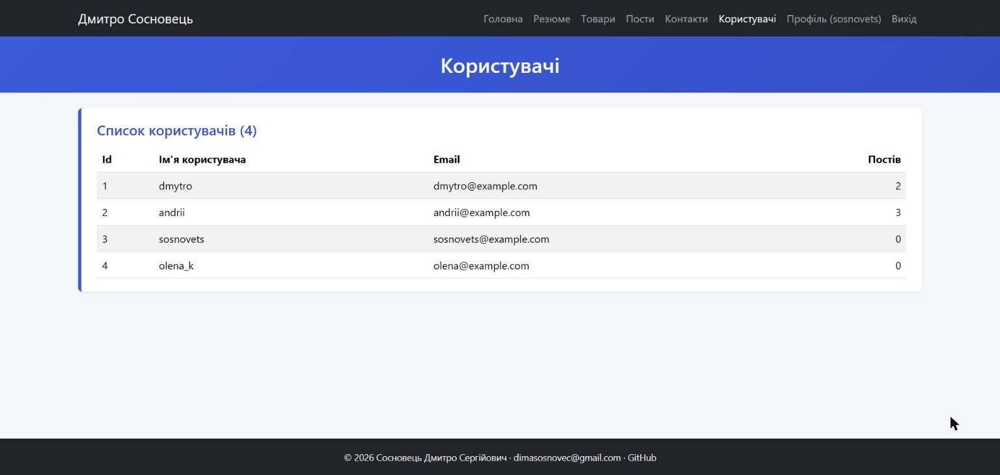

### Частина 2. Вихід і захист сторінок
**Вихід із системи: у меню знову «Вхід» і «Реєстрація»**

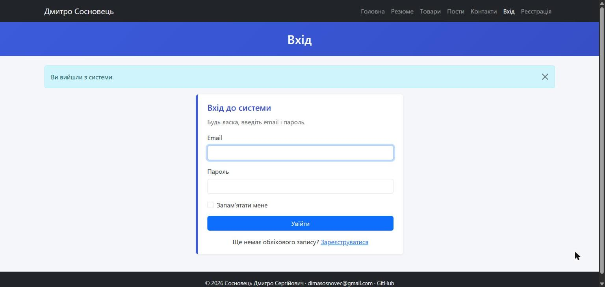

**Гість відкриває `/users/` → перенаправлення на вхід (`?next=/users/`) з повідомленням**

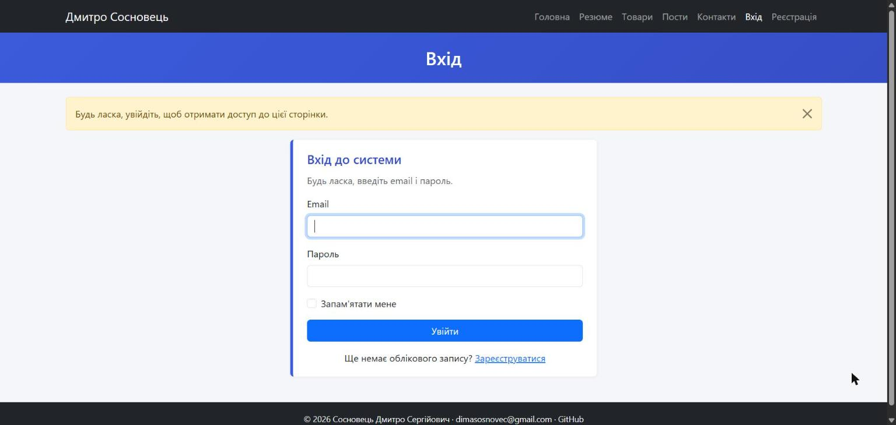

### Частина 3. Тести
**`python -m unittest tests.test_auth -v` і `python -m unittest discover tests` — 210 тестів, усі проходять**

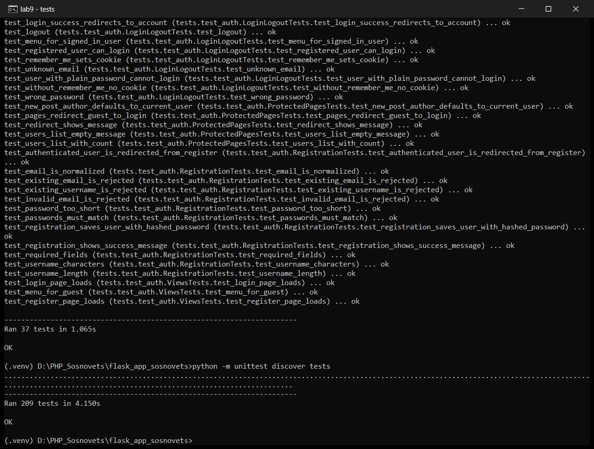

## Структура (нове в цій лабораторній)
```
app/__init__.py                  bcrypt = Bcrypt(), login_manager = LoginManager()
app/users/models.py              User(db.Model, UserMixin), user_loader, hash_password(), check_password()
app/users/forms.py               RegistrationForm, LoginForm
app/users/views.py               register, login, account, users_list, logout (+ @login_required)
app/users/templates/users/       register.html, login.html, account.html, users.html
app/templates/includes/navbar.html   меню для гостя й авторизованого користувача
tests/test_auth.py               тести реєстрації, входу, виходу, захищених сторінок
```

## Запуск
```bash
python -m venv .venv
.venv\Scripts\activate
pip install -r requirements.txt
copy .env.example .env
flask db upgrade
flask run                                  # http://127.0.0.1:8080
python -m unittest discover tests -v
```
