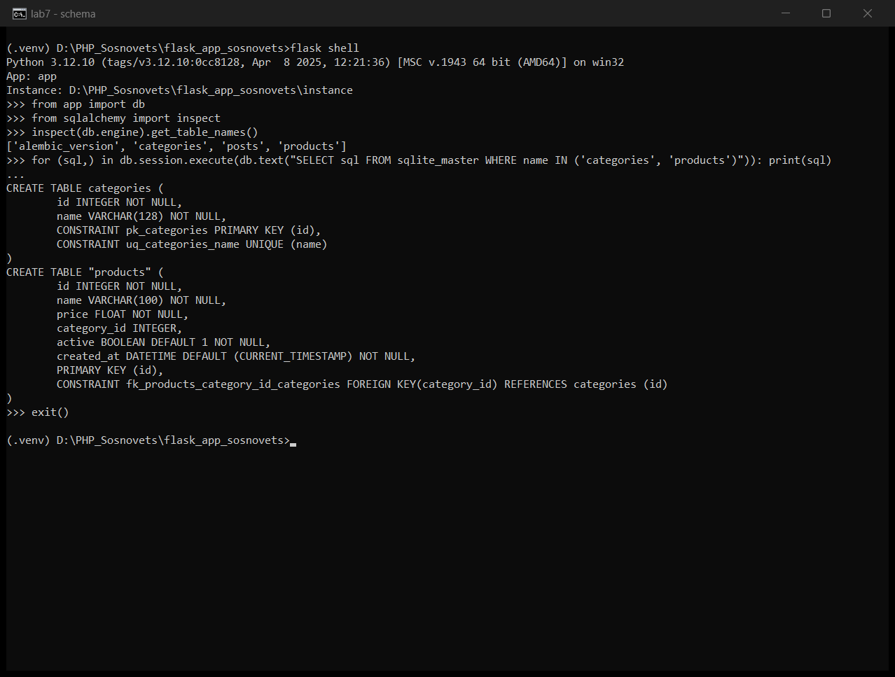
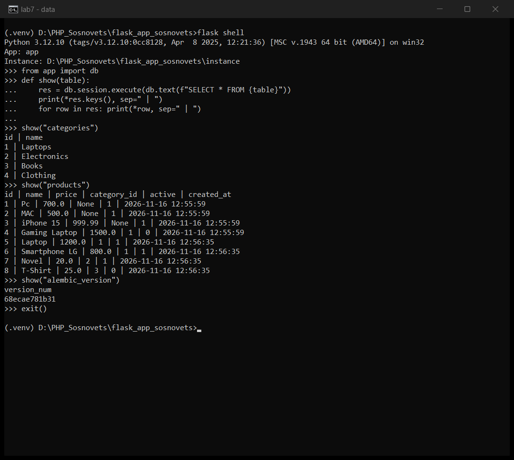
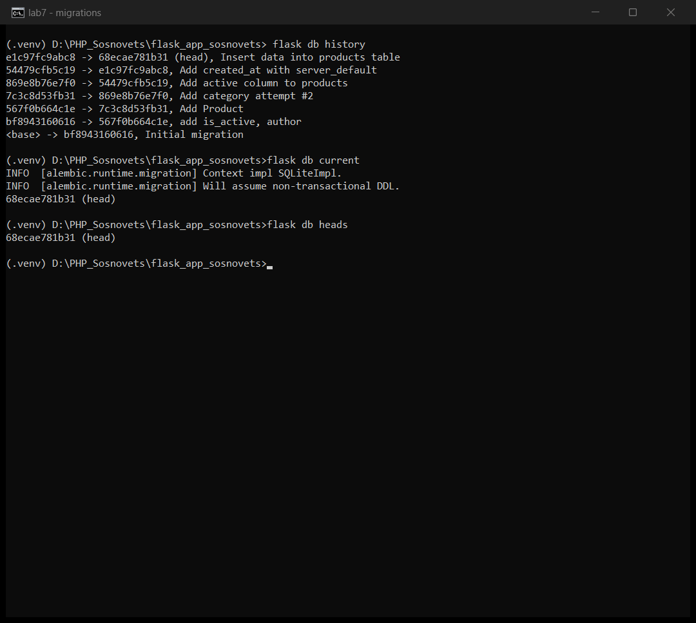

# Лабораторна робота №7. Зв'язки. Робота із міграціями

**Студент:** Сосновець Дмитро Сергійович, ІПЗ-33
**Гілка:** [`lab7`](https://github.com/dmytrososnovets24-glitch/flask-app-lab/tree/lab7) (створена з `lab6`)

## Мета
Набути практичних навичок створення моделей із зовнішніми ключами, проведення та відкату міграцій, синхронізації структури бази з моделями, а також виправлення помилок, що виникають під час змін у схемі БД.

Пререквізити (доступ до бази даних, об'єкт `db` класу `SQLAlchemy`, Flask-Migrate) уже налаштовані в проєкті: `app/__init__.py`, `app/config.py`, каталог `migrations/`.

## Хід роботи

### Частина 1. Початок роботи
- У блюпринті `products` створено файл `app/products/models.py` з моделлю `Product` (`id`, `name` — String(100), `price` — Float).
- Команду `flask db init` повторно не виконував: каталог `migrations` у проєкті вже існує, а ця команда запускається лише один раз.
- `flask db migrate -m "Add Product"` → `flask db upgrade` — у базі з'явилася таблиця `products`.
- Через `flask shell` додано два товари: `Pc` (700) і `MAC` (500), вибірка `select(Product)` повертає обидва.

### Частина 2. Модель `Category`, зв'язок «один до багатьох»
- Додано модель `Category` (`id`, `name` — String(128), unique) і двосторонній зв'язок: `Category.products` ↔ `Product.category`, зовнішній ключ `Product.category_id → categories.id`.
- `flask db migrate -m "Add category"` згенерувала рядок `batch_op.create_foreign_key(None, 'categories', ...)`, тому `flask db upgrade` завершилась помилкою:
  ```
  ValueError: Constraint must have a name
  ```
- Виправлення: у файлі міграції вказано ім'я обмеження — `batch_op.create_foreign_key('category_id', 'categories', ['category_id'], ['id'])`.
- Після невдалої спроби в базі залишилась таблиця `categories` (SQLite не відкочує DDL), через що повторний `upgrade` падав з `table categories already exists`. Таблицю видалено вручну, після цього `flask db upgrade` виконалась.
- `flask db migrate` → `No changes in schema detected`, `flask db check` → `No new upgrade operations detected`.
- `flask db downgrade` теж не виконувалась (`drop_constraint(None, ...)`). У функції `downgrade()` виправлено на `batch_op.drop_constraint('category_id', type_='foreignkey')`, після чого відкат пройшов: у базі знову лише `products` із двома товарами.

### Частина 3. Єдиний стиль іменування обмежень
- У клас `Base` (`app/__init__.py`) додано `MetaData(naming_convention={...})` з шаблонами для `ix`, `uq`, `ck`, `fk`, `pk`.
- Відкочений файл першої спроби видалено, виконано `flask db migrate -m "Add category attempt #2"`. Тепер імена генеруються автоматично: `pk_categories`, `uq_categories_name`, `fk_products_category_id_categories`.
- `flask db upgrade` виконалась без правок файлу міграції, `flask db check` → `No new upgrade operations detected`.

### Частина 4. Нове поле `active` у моделі `Product`
- Додано `active: Mapped[bool] = mapped_column(Boolean, nullable=False, default=True)`.
- `flask db check` → `ERROR [flask_migrate] Error: New upgrade operations detected: [('add_column', None, 'products', Column('active', Boolean(), ...))]`.
- `flask db migrate -m "Add active column to products"`, далі `flask db upgrade` завершилась помилкою:
  ```
  sqlalchemy.exc.OperationalError: (sqlite3.OperationalError) Cannot add a NOT NULL column with default value NULL
  [SQL: ALTER TABLE products ADD COLUMN active BOOLEAN NOT NULL]
  ```
- У цей момент `flask db check` → `Target database is not up to date`, `flask db current` показує `869e8b76e7f0`, а `flask db heads` — `54479cfb5c19`: база відстає від каталогу міграцій.
- Виправлення (3-й спосіб): у файлі міграції стовпець додається з `server_default=sa.true()`. Після цього `flask db upgrade` виконалась, наявні рядки отримали `active = 1`, `flask db check` → `No new upgrade operations detected`.
- `flask db current --verbose` і `flask db heads` показують ту саму ревізію `54479cfb5c19 (head)`.

### Частина 5. Заповнення даними
Через `flask shell` додано товар `iPhone 15` (999.99), категорію `Laptops` і товар `Gaming Laptop` (1500.00, `active=False`, `category=laptops`). Перевірка зв'язку:
```
>>> product.category.name
'Laptops'
>>> laptops.products
[<Product Gaming Laptop - $1500.0>]
```
У SQLAlchemy 2.x товар, прив'язаний через `category=laptops`, сам у сесію не потрапляє, тому перед `commit()` потрібен `db.session.add(product)`.

### Частина 6. Поле `created_at`
1. Додано `created_at` з `default=datetime.utcnow`, `flask db migrate -m "Add created_at"`. `flask db upgrade` завершилась помилкою `Cannot add a NOT NULL column with default value NULL [SQL: ALTER TABLE products ADD COLUMN created_at DATETIME NOT NULL]`.
2. У файлі міграції додано `server_default=sa.text("CURRENT_TIMESTAMP")` — міграція застосувалась, усі рядки отримали дату й час.
3. Виконано `flask db downgrade`, файл цієї міграції видалено, а в моделі задано `server_default=func.now()`.
4. `flask db migrate -m "Add created_at with server_default"` — файл згенеровано коректно (`server_default=sa.text('(CURRENT_TIMESTAMP)')`), `flask db upgrade` пройшла без правок.

### Частина 7. Міграція вручну для додавання даних
- Моделі й база синхронізовані, тому `flask db migrate` повертає `No changes in schema detected`.
- `flask db revision -m "Insert data into products table"` створила порожній файл; функції `upgrade()` і `downgrade()` замінено: `op.bulk_insert` додає категорії `Electronics`, `Books`, `Clothing` і товари `Laptop`, `Smartphone LG`, `Novel`, `T-Shirt`, а `downgrade()` видаляє саме ці записи за назвами.
- `flask db upgrade` — дані з'явились у таблицях. Додатково перевірено `flask db downgrade` (вставлені рядки зникають) і повторний `flask db upgrade`.

## Підсумкові моделі (`app/products/models.py`)
```python
class Category(db.Model):
    __tablename__ = 'categories'

    id: Mapped[int] = mapped_column(Integer, primary_key=True)
    name: Mapped[str] = mapped_column(String(128), nullable=False, unique=True)

    products: Mapped[list['Product']] = relationship(
        'Product', back_populates='category', lazy='select')


class Product(db.Model):
    __tablename__ = 'products'

    id: Mapped[int] = mapped_column(Integer, primary_key=True)
    name: Mapped[str] = mapped_column(String(100), nullable=False)
    price: Mapped[float] = mapped_column(Float, nullable=False)
    active: Mapped[bool] = mapped_column(Boolean, nullable=False, default=True)
    created_at: Mapped[datetime] = mapped_column(
        DateTime(timezone=True), nullable=False, server_default=func.now())

    category_id: Mapped[int | None] = mapped_column(db.ForeignKey('categories.id'))
    category: Mapped['Category'] = relationship('Category', back_populates='products')
```

## Файли міграцій (`migrations/versions/`)
| Ревізія | Повідомлення | Що робить |
|---|---|---|
| `7c3c8d53fb31` | Add Product | таблиця `products` |
| `869e8b76e7f0` | Add category attempt #2 | таблиця `categories`, стовпець `products.category_id`, зовнішній ключ `fk_products_category_id_categories` |
| `54479cfb5c19` | Add active column to products | стовпець `active` з `server_default=sa.true()` |
| `e1c97fc9abc8` | Add created_at with server_default | стовпець `created_at` з `server_default` |
| `68ecae781b31` | Insert data into products table | вставка категорій і товарів (`op.bulk_insert`) |

Дві перші ревізії в історії (`bf8943160616`, `567f0b664c1e`) — це міграції таблиці `posts`, які вже були в проєкті.

## Скриншоти

### Остаточна схема таблиць
**Таблиці бази та SQL-схема `categories` і `products` (імена обмежень за `naming_convention`, значення за замовчуванням для `active` і `created_at`)**



### Остаточні дані у БД
**Таблиці `categories`, `products` і `alembic_version`**



### Історія міграцій
**`flask db history`; поточна ревізія бази (`flask db current`) збігається з останньою доступною (`flask db heads`)**



## Тести
- `tests/test_product_models.py` — 19 тестів: моделі `Product` і `Category`, зв'язок «один до багатьох», унікальність назви категорії, імена обмежень, а також повний ланцюжок міграцій на порожній базі (`upgrade` до останньої ревізії, збіг схеми з моделями, `downgrade`).
- Усього в проєкті 143 тести, усі проходять. Повний вивід: [docs/test_results.txt](docs/test_results.txt).

## Запуск
```bash
python -m venv .venv
.venv\Scripts\activate
pip install -r requirements.txt
copy .env.example .env
flask db upgrade                           # створює таблиці й вставляє дані
flask db history
flask run                                  # http://127.0.0.1:8080
python -m unittest discover tests -v
```
