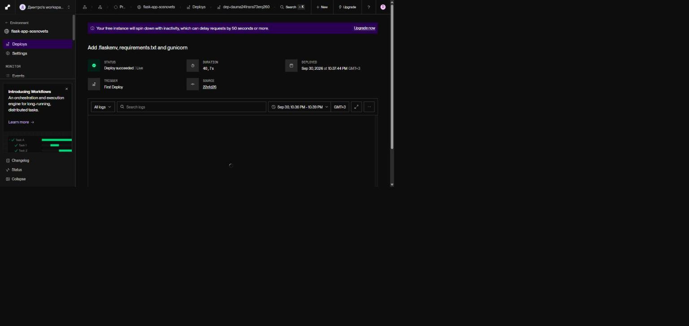
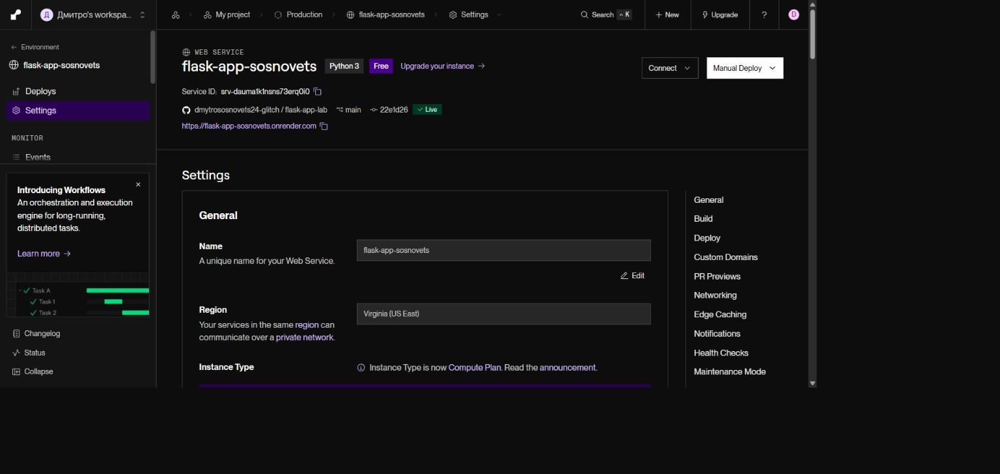
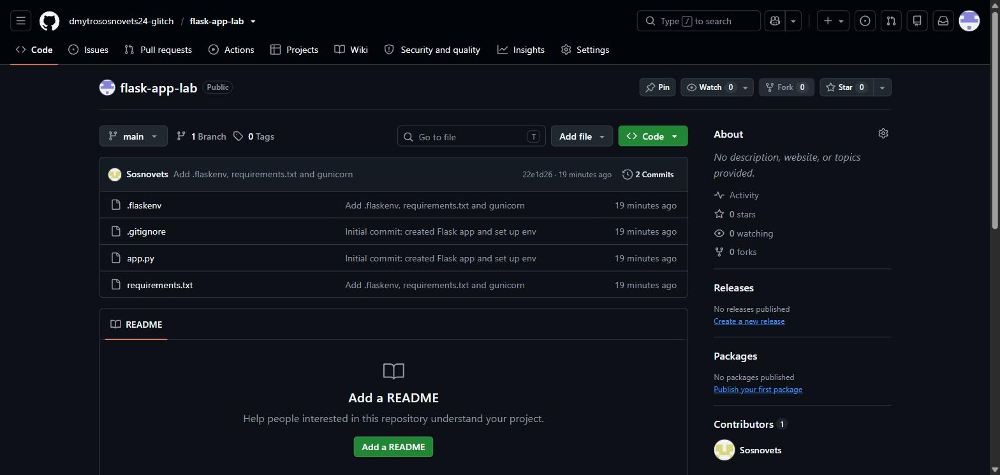
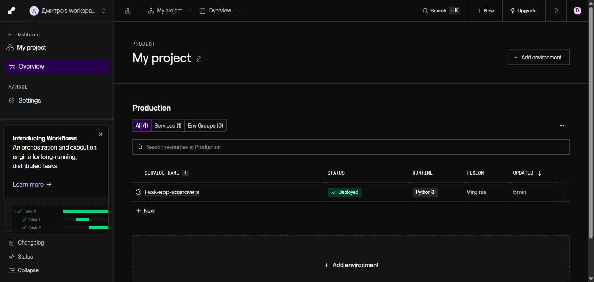
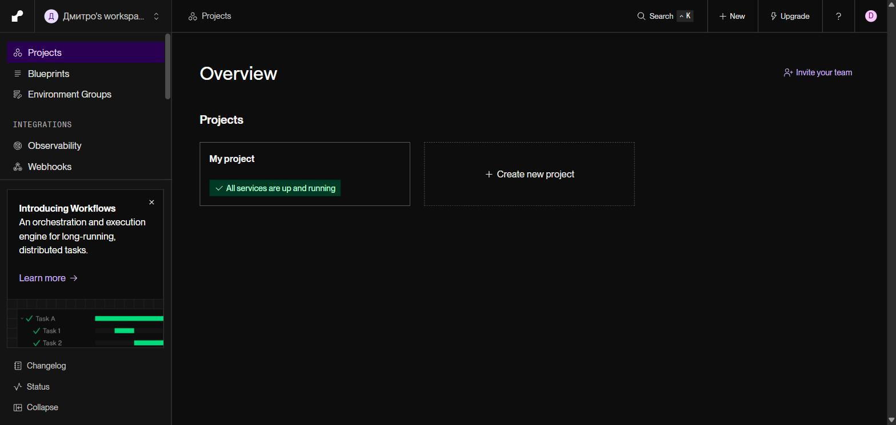

# Flask: навчальні лабораторні роботи

**Студент:** Сосновець Дмитро Сергійович, КНУ імені Василя Стефаника, ІПЗ-33
**Курс:** Вебпрограмування мовою Python
**Розгорнутий сайт:** https://flask-app-sosnovets.onrender.com/

Кожна лабораторна виконана у власній гілці, кожна наступна створена з попередньої. Гілка `main` містить усі роботи (лаби 3–5 злиті) і розгортається на Render.

| Лаба | Тема | Гілка |
|---|---|---|
| 1 | Найпростіший Flask-додаток, venv, Git, розгортання на Render | `main` (цей файл) |
| 2 | Маршрутизація та шаблони (резюме й контакти) | [`lab2`](../../tree/lab2) |
| 3 | Модульна структура, Blueprints, unittest | [`lab3`](../../tree/lab3) |
| 4 | Сесії та кукі, flash, кольорова схема | [`lab4`](../../tree/lab4) |
| 5 | WTF-форми, TinyDB, CRUD товарів | [`lab5`](../../tree/lab5) |

У кожній гілці є власний `README.md` зі звітом і скриншотами.

---

## Лабораторна робота №1. Найпростіший Flask-додаток

### Що зроблено
1. Створено каталог проєкту `flask_app_sosnovets` і віртуальне середовище `.venv`; перевірено `pip list`, оновлено `pip`, встановлено Flask (`pip install flask`, `pip show flask` — версія 3.0.3).
2. Ініціалізовано Git-репозиторій, `.gitignore` виключає віртуальне середовище.
3. Файл `app.py` без коментарів:
   ```python
   from flask import Flask
   app = Flask(__name__)

   @app.route('/')
   def main():
       return 'Hello, world!'

   if __name__ == '__main__':
       app.run(debug=True)
   ```
4. Запуск `python app.py` (порт 5000) і `flask run`; режим debug вмикається через `.flaskenv` (`FLASK_DEBUG=1`, `FLASK_APP=app.py`, `FLASK_RUN_PORT=8080`) за допомогою `python-dotenv`.
5. Створено `requirements.txt` (Flask, python-dotenv, gunicorn), коміти й репозиторій `flask-app-lab` на GitHub.
6. Розгортання на Render.com: Build Command `pip install -r requirements.txt`, Start Command `gunicorn app:app`, тариф Free, гілка `main`.

### Скриншоти
**Розгортання на Render завершено (Deploy succeeded)**


**Налаштування сервісу на Render**


**Репозиторій на GitHub**


**Дашборд Render: список сервісів**


**Дашборд Render: огляд проєктів**

