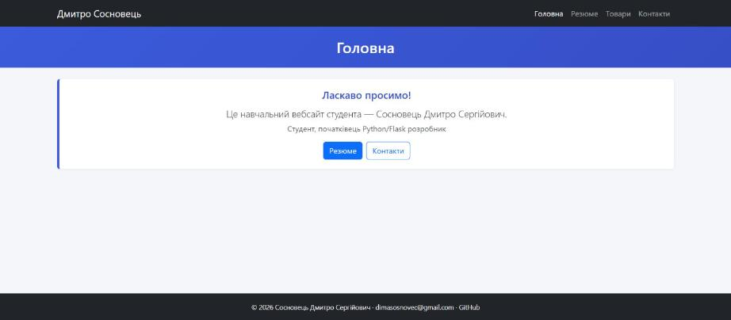
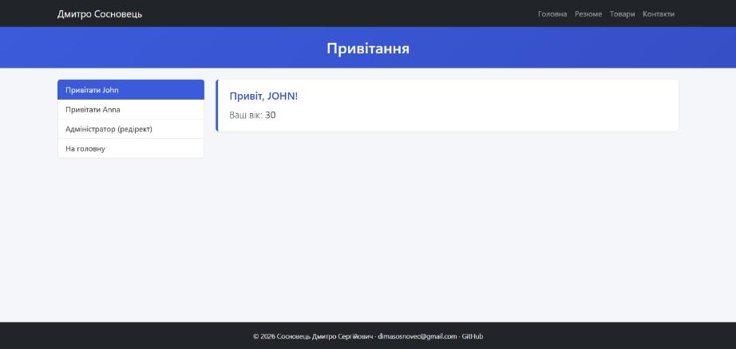
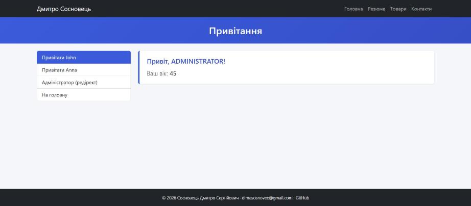
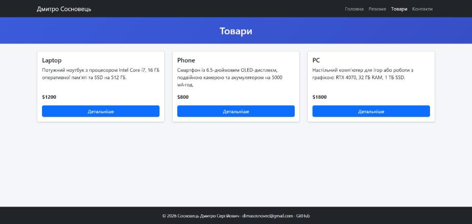
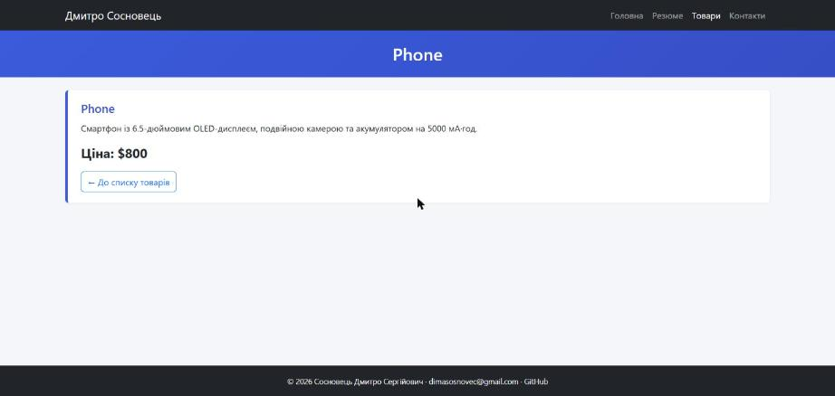

# Лабораторна робота №3. Модульна структура. Blueprints

**Студент:** Сосновець Дмитро Сергійович, ІПЗ-33
**Гілка:** `lab3` (створена з `lab2`)

## Завдання
Розділити Flask-застосунок на модулі за допомогою Blueprints, зробити ієрархію шаблонів із `base.html` і написати модульні тести на `unittest`.

## Що реалізовано
1. **Структура пакета `app/`** — шаблони й статика перенесені в `app/`, створення застосунку — в `app/__init__.py`, маршрути — в `app/views.py`, окремий шаблон `homepage.html` для головної, точка входу — `run.py` (колишній `app.py`), налаштування — `config.py`.
2. **Blueprint `users`** (префікс `/users`): привітання `/users/hi/<name>?age=…` (ім'я переводиться у верхній регістр, `age` — з рядка запиту), `/users/admin` — редірект на привітання. Шаблон `hi.html` наслідує `base.html`, має вертикальне меню (тільки для цієї сторінки) і маршрути через `url_for('users.greetings', …)`.
3. **Blueprint `products`** (префікс `/products`): список товарів `/products/` (`products.html`) і сторінка товару `/products/<id>` (`detail_product.html`); товари — масив `products` (id, name, price, content). Неіснуючий id — 404.
4. **Тести** (`tests/`, `unittest`): 9 тестів для блюпринтів `users` і `products`.

## Структура
```
run.py, config.py
app/        __init__.py, views.py, templates/ (base, homepage, resume, contacts, includes/), static/
app/users/      __init__.py, views.py, templates/users/hi.html
app/products/   __init__.py, views.py, templates/products/{products,detail_product}.html
tests/      test_user_bp.py, test_products_bp.py
```

## Запуск і тести
```bash
pip install -r requirements.txt
flask run                                  # http://127.0.0.1:8080
python -m unittest discover tests -v       # Ran 9 tests ... OK
```
Результат тестів: [docs/test_results.txt](docs/test_results.txt)

## Скриншоти
**Головна сторінка (`homepage.html`)**


**`/users/hi/John?age=30`**


**`/users/admin` — редірект на `/users/hi/administrator?age=45`**


**Список товарів `/products/`**


**Деталі товару `/products/2`**

