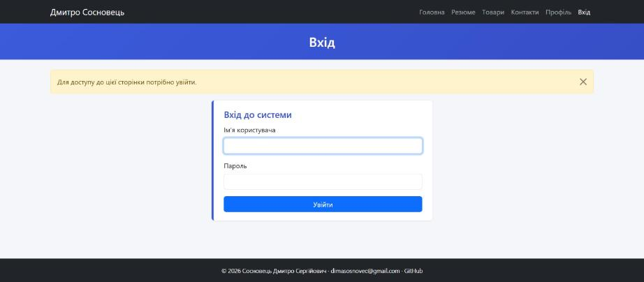
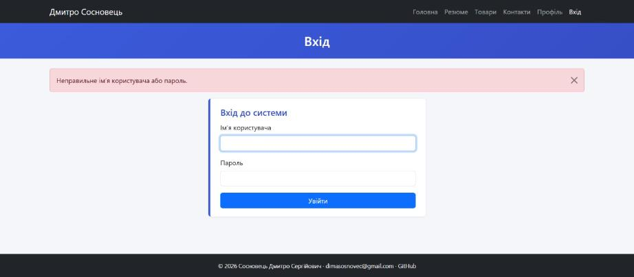
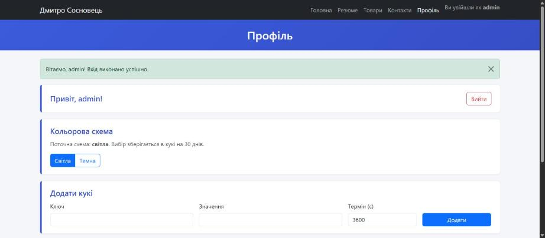
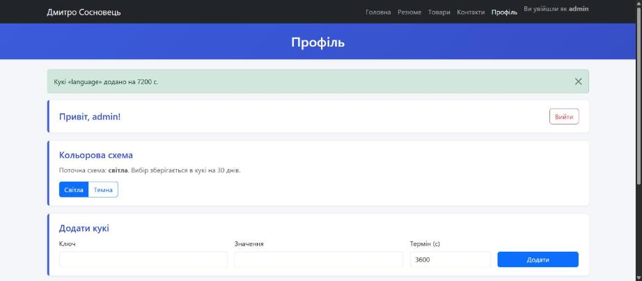
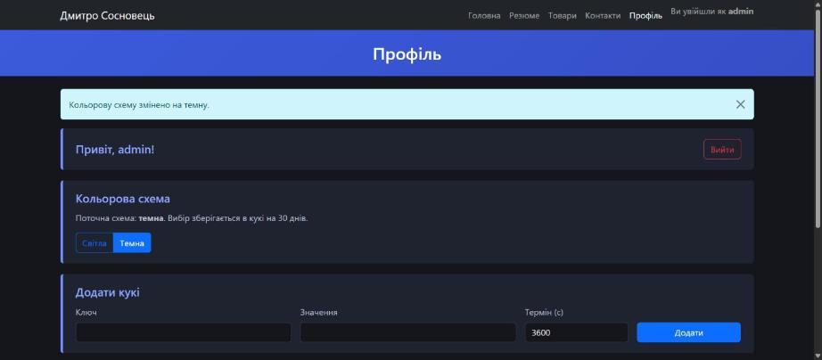
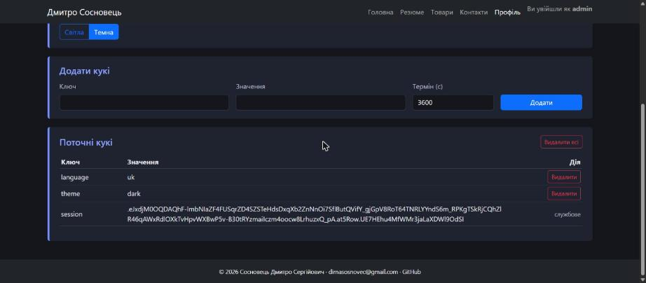

# Лабораторна робота №4. Об'єкт запиту request. Сесії та кукі

**Студент:** Сосновець Дмитро Сергійович, ІПЗ-33
**Гілка:** `lab4` (створена з `lab3`). Код — у блюпринті `users`.

## Завдання
flash-повідомлення з категоріями, вхід/вихід із сесією, керування кукі та вибір кольорової схеми.

## Що реалізовано
- **flash з категоріями** у `base.html` (`includes/flash.html`, Bootstrap-alert: success / error / warning / info).
- **Вхід `/users/login`:** форма з полями `username` і `password`. Правильні дані — заглушка в `config.py` (`admin` / `12345`, без БД). Успіх: користувач записується в `session`, flash і редірект на `profile`; помилка: повернення на `login` із flash.
- **Профіль `/users/profile`:** привітання з ім'ям із сесії; без сесії — редірект на `login` з повідомленням (декоратор `login_required`).
- **Вихід:** кнопка «Вийти» (POST `/users/logout`) видаляє користувача з сесії й веде на `login`.
- **Кукі на сторінці профілю:** додавання (ключ, значення, термін дії в секундах), видалення окремого кукі, видалення всіх (службове кукі `session` не чіпається), таблиця поточних кукі, flash про результат.
- **Кольорова схема:** `/users/theme/<light|dark>` зберігає вибір у кукі `theme` (30 днів) і редіректить на профіль; шаблон `profile.html` має умовні стилі для світлої й темної схем.
- **Навігація:** меню з посиланнями на головну, резюме, товари, контакти, профіль, вхід.
- **Тести:** 26 (`unittest`), у т.ч. вхід, захист профілю, кукі, тема.

## Маршрути
| URL | Метод | Призначення |
|---|---|---|
| `/users/login` | GET, POST | форма входу |
| `/users/profile` | GET | профіль (потрібна сесія) |
| `/users/logout` | POST | вихід |
| `/users/cookies/add`, `/delete`, `/delete-all` | POST | керування кукі |
| `/users/theme/<light\|dark>` | GET | вибір кольорової схеми |

## Запуск і тести
```bash
pip install -r requirements.txt
flask run                                  # http://127.0.0.1:8080
python -m unittest discover tests -v       # Ran 26 tests ... OK
```
Результат тестів: [docs/test_results.txt](docs/test_results.txt)

## Скриншоти
**Спроба відкрити профіль без входу — flash-попередження**


**Неправильний пароль — flash-помилка**


**Успішний вхід, сторінка профілю**


**Кукі додано**


**Темна кольорова схема**


**Таблиця кукі (темна схема)**

