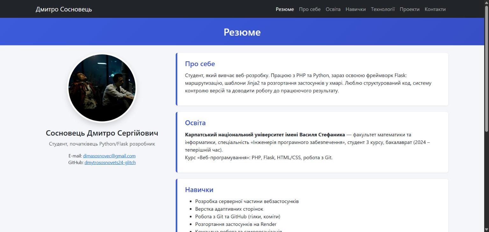
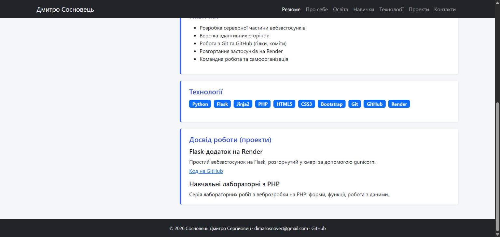
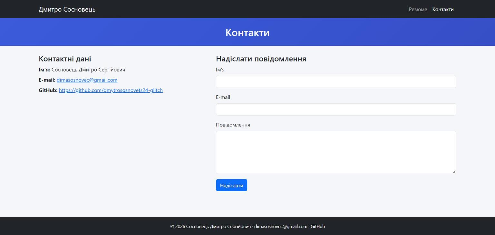

# Лабораторна робота №2. Маршрутизація та шаблони

**Студент:** Сосновець Дмитро Сергійович, ІПЗ-33
**Гілка:** `lab2` · **Сайт:** https://flask-app-sosnovets.onrender.com/

## Завдання
Невеликий вебсайт із двох сторінок — «Резюме» та «Контакти» — зі спільним базовим шаблоном, навігацією, статичними файлами та стилями Bootstrap.

## Що реалізовано
- **Маршрути** (`app.py`): `/` і `/resume` — резюме, `/contacts` — контакти з формою-заглушкою (відправка не виконується, лише повідомлення «Дякуємо»).
- **Наслідування шаблонів:** `templates/base.html` містить заголовок сторінки (змінна `title`, що передається з маршруту), підключення Bootstrap і власного CSS, блок `content`.
- **`include`:** навігаційне меню (`includes/navbar.html`) і футер (`includes/footer.html`) підключаються в `base.html`.
- **Резюме:** секції `<section>` — «Про себе», «Освіта», «Навички», «Технології», «Досвід роботи (проекти)», фото. У меню є якорі на секції.
- **Статичні файли:** CSS і фото лежать у `static/`, підключені через `url_for('static', filename=...)`.
- **Адаптивність:** Bootstrap 5, меню згортається на мобільних пристроях; власні стилі — `static/css/styles.css`.

## Структура
```
app.py
templates/   base.html, resume.html, contacts.html, includes/{navbar,footer}.html
static/      css/styles.css, images/photo.jpg
requirements.txt, .flaskenv, .gitignore
```

## Запуск
```bash
python -m venv .venv
.venv\Scripts\activate
pip install -r requirements.txt
flask run          # http://127.0.0.1:8080
```

## Скриншоти
**Резюме (розгорнутий сайт на Render), верх сторінки**


**Резюме, нижня частина (технології, проекти, футер)**


**Сторінка «Контакти»**

