# Лабораторна робота №6. ORM. Вступ до SQLAlchemy. Операції CRUD

**Студент:** Сосновець Дмитро Сергійович, ІПЗ-33
**Гілка:** [`lab6`](https://github.com/dmytrososnovets24-glitch/flask-app-lab/tree/lab6) (створена з `lab5`)

## Завдання
Веб-додаток для керування публікаціями (постами): дані зберігаються через ORM SQLAlchemy (синтаксис 2.0), реалізовано CRUD-операції, міграції Flask-Migrate, форми Flask-WTF, модульні тести `unittest`.

## Що зроблено

### Частина 1. Налаштування, application factory
- Встановлено `flask-sqlalchemy` і `flask-migrate` (додано в `requirements.txt`).
- `app/config.py` — класи `Config`, `DevelopmentConfig`, `TestingConfig` (SQLite в пам'яті, CSRF вимкнено), `ProductionConfig`.
- `app/__init__.py` — фабрика `create_app(config_name)`: вибір конфігурації, ініціалізація `SQLAlchemy` і `Migrate`, реєстрація блюпринтів, обробник помилки 404 (шаблон `404.html`).
- Змінні середовища: `.flaskenv` (`FLASK_APP`, `FLASK_CONFIG`, порт) і `.env` (`SECRET_KEY`, `DATABASE_URL`). Файл `.env` не потрапляє в git, у репозиторії є шаблон `.env.example`.
- Маршрути головних сторінок винесено в блюпринт `main`, точка входу — `run.py`.

### Частина 2. Блюпринт `posts`, модель `Post`
- `app/posts/__init__.py` — блюпринт `post_bp` із власними шаблонами та статикою.
- `app/posts/models.py` — модель `Post`: `id`, `title` (String(150), not null), `content` (Text, not null), `posted` (DateTime, за замовчуванням поточний час UTC), `category` (Enum: news, publication, tech, other), метод `__repr__`.
- У Flask Shell вручну створено базу (`db.create_all()`), додано пости, виконано запити, видалено пост, після чого таблиці та папку `instance` видалено.

### Частина 3. Міграції
- `flask db init`, `flask db migrate -m "Initial migration"`, `flask db upgrade` — створено `instance/data.sqlite` з таблицями `posts` і `alembic_version`.
- До моделі додано поля `is_active` (Boolean, default True) і `author` (String(20), default 'Anonymous'), виконано `flask db migrate -m "add is_active, author"` і `flask db upgrade`.
- Скрипти міграцій лежать у `migrations/versions/`.

### Частина 4. CRUD (за TDD: спочатку тести, потім код)
| Метод | Шлях | Дія | Шаблон |
|---|---|---|---|
| GET / POST | `/post/create` | створення поста | `add_post.html` |
| GET | `/post` | список видимих постів, новіші зверху | `posts.html` |
| GET | `/post/<id>` | перегляд поста | `detail_post.html` |
| GET / POST | `/post/<id>/update` | редагування поста | `add_post.html` |
| GET / POST | `/post/<id>/delete` | підтвердження і видалення | `delete_confirm.html` |

- Форма `PostForm` (`app/posts/forms.py`): `title`, `content`, `is_active`, `publish_date` (DateTimeLocalField), `category` (SelectField), `submit`; поля виводяться макросом `render_field`.
- Автор поста — користувач із сесії, інакше `Anonymous`; поля автора у формі немає.
- Після кожної операції — flash-повідомлення і перенаправлення (Post/Redirect/Get).
- При редагуванні форма заповнюється даними поста (`PostForm(obj=post)`), дата публікації підставляється вручну, зміни записуються через `form.populate_obj(post)`.

### Частина 5. Стилізація
- `app/posts/static/css/posts.css` — стилі карток, міток категорій, сторінок поста; підключається через блок `css` базового шаблону.
- `app/posts/static/img/default.jpg` — зображення для карток постів.
- У списку текст поста обрізається до 100 символів (`post.content[:100]`).

### Тести
- `tests/test_posts.py` — 35 тестів: модель, створення, перегляд, редагування, видалення, валідація, CSRF, сторінка 404.
- Усього в проєкті 124 тести, усі проходять. Повний вивід: [docs/test_results.txt](docs/test_results.txt).

## Структура (нове в цій лабораторній)
```
run.py, .flaskenv, .env.example
app/__init__.py          create_app(), db, migrate, обробник 404
app/config.py            Config, DevelopmentConfig, TestingConfig, ProductionConfig
app/templates/           base.html (блок css), 404.html, macros/form_macros.html
app/posts/               __init__.py, models.py, forms.py, views.py
app/posts/static/        css/posts.css, img/default.jpg
app/posts/templates/posts/   posts.html, detail_post.html, add_post.html, delete_confirm.html
migrations/              скрипти міграцій Alembic
tests/                   __init__.py, test_posts.py (+ тести попередніх лабораторних)
```

## Запуск
```bash
python -m venv .venv
.venv\Scripts\activate
pip install -r requirements.txt
copy .env.example .env
flask db upgrade
flask run                                  # http://127.0.0.1:8080
python -m unittest discover tests -v
```

## Скриншоти

### Частина 2. Робота з базою у Flask Shell
**Створення таблиць, додавання постів, запити, видалення поста, `db.drop_all()` і видалення папки `instance`**

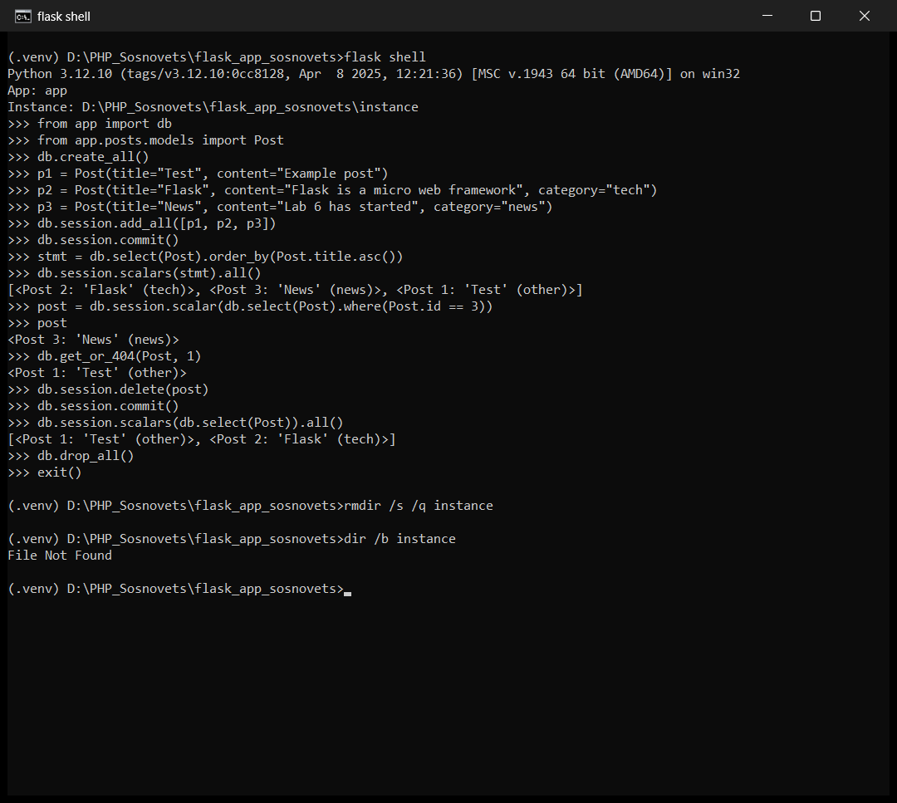

### Частина 3. Міграції
**`flask db init`, `flask db migrate -m "Initial migration"`, `flask db upgrade`; у базі з'явилися таблиці `alembic_version` і `posts`**

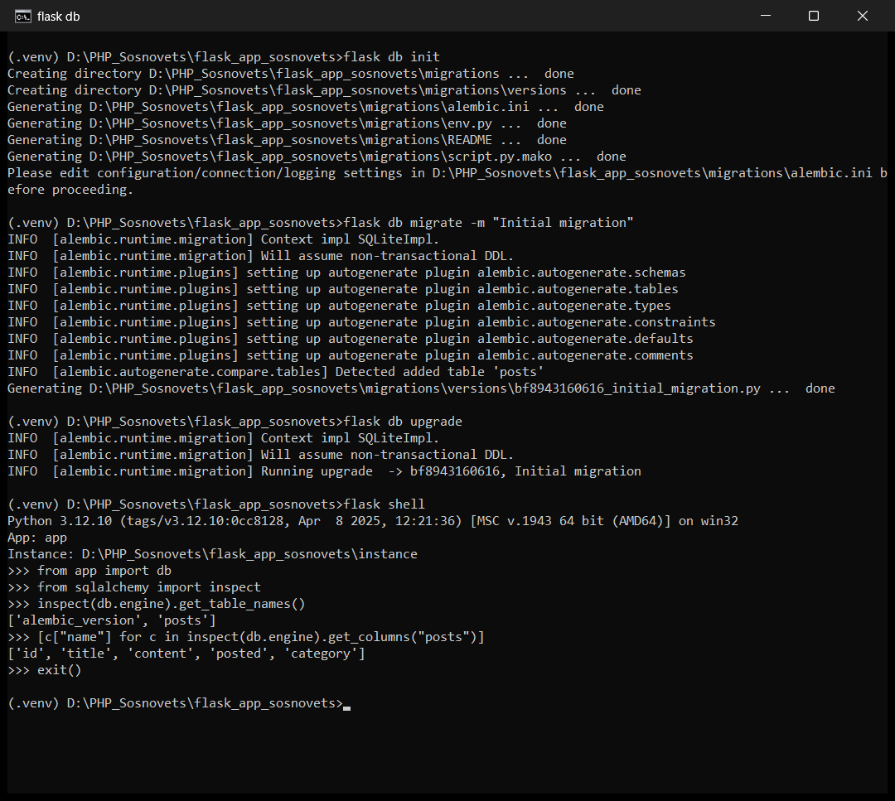

**Міграція після додавання полів `is_active` і `author`, історія міграцій, нові стовпці в таблиці**

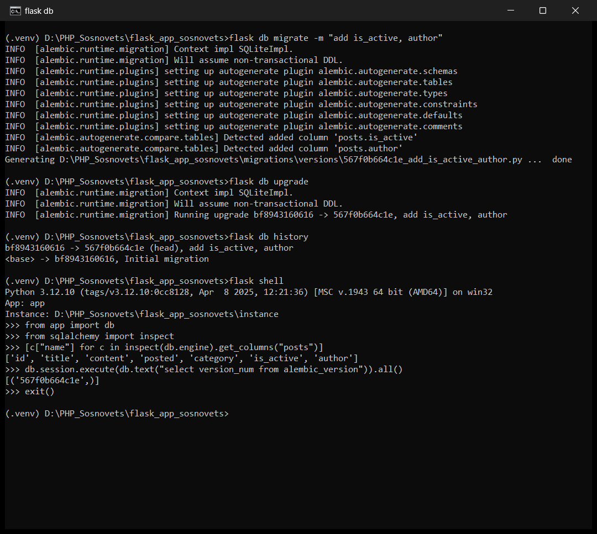

### Частина 6. Ручне тестування інтерфейсу
**Додавання поста: заповнена форма**

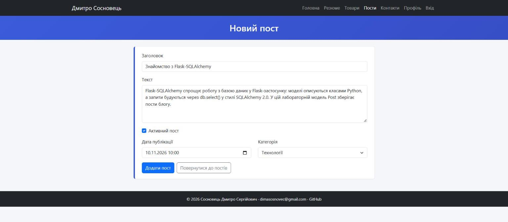

**Після додавання: повідомлення і новий пост у списку**

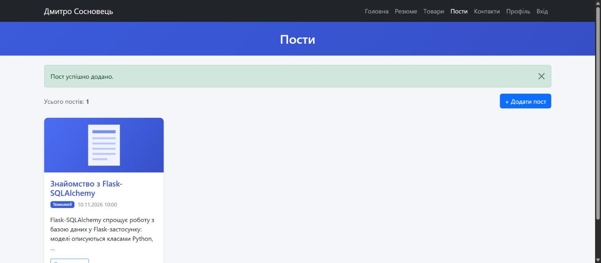

**Відображення постів: список карток (новіші зверху)**

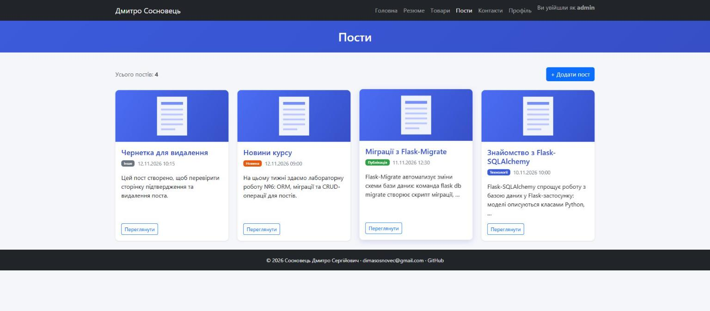

**Перегляд одного поста (автор — користувач із сесії)**

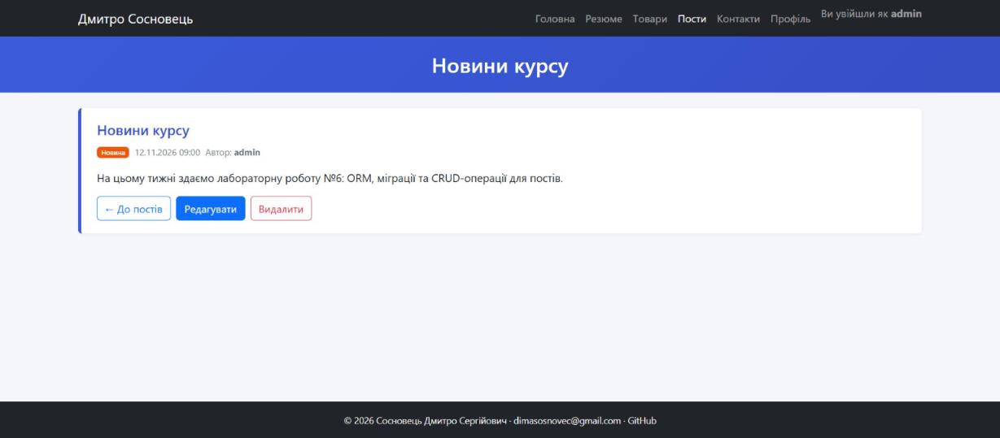

**Редагування: форма з поточними даними поста**

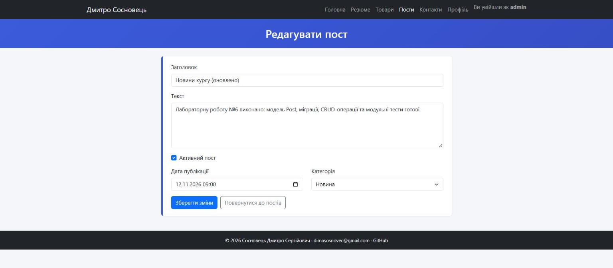

**Після редагування: повідомлення й оновлений пост**

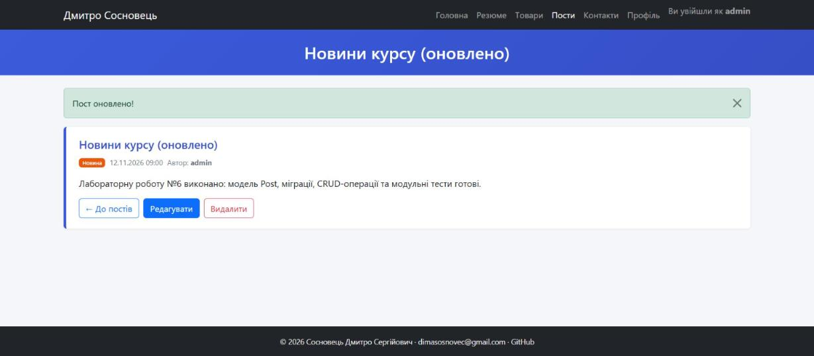

**Видалення: сторінка підтвердження**

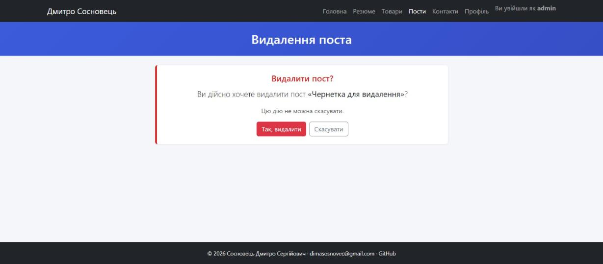

**Після видалення: повідомлення й оновлений список**

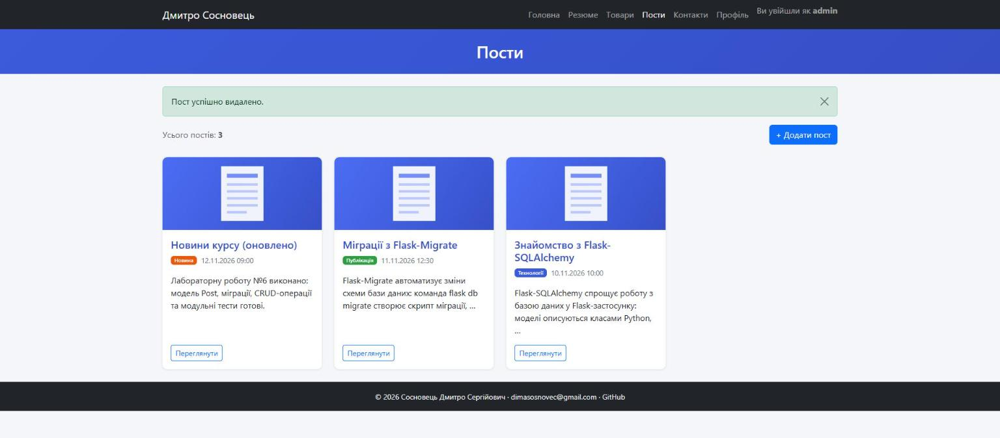

**Сторінка помилки 404 для неіснуючого поста**

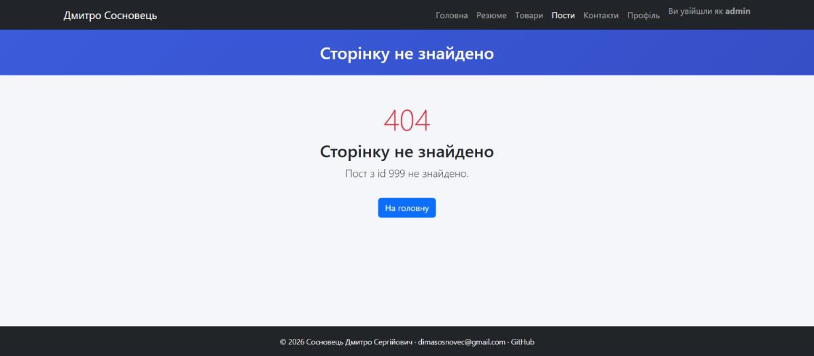

**Ті самі пости в базі даних (запит у Flask Shell): три пости, видаленого поста з id 4 немає**

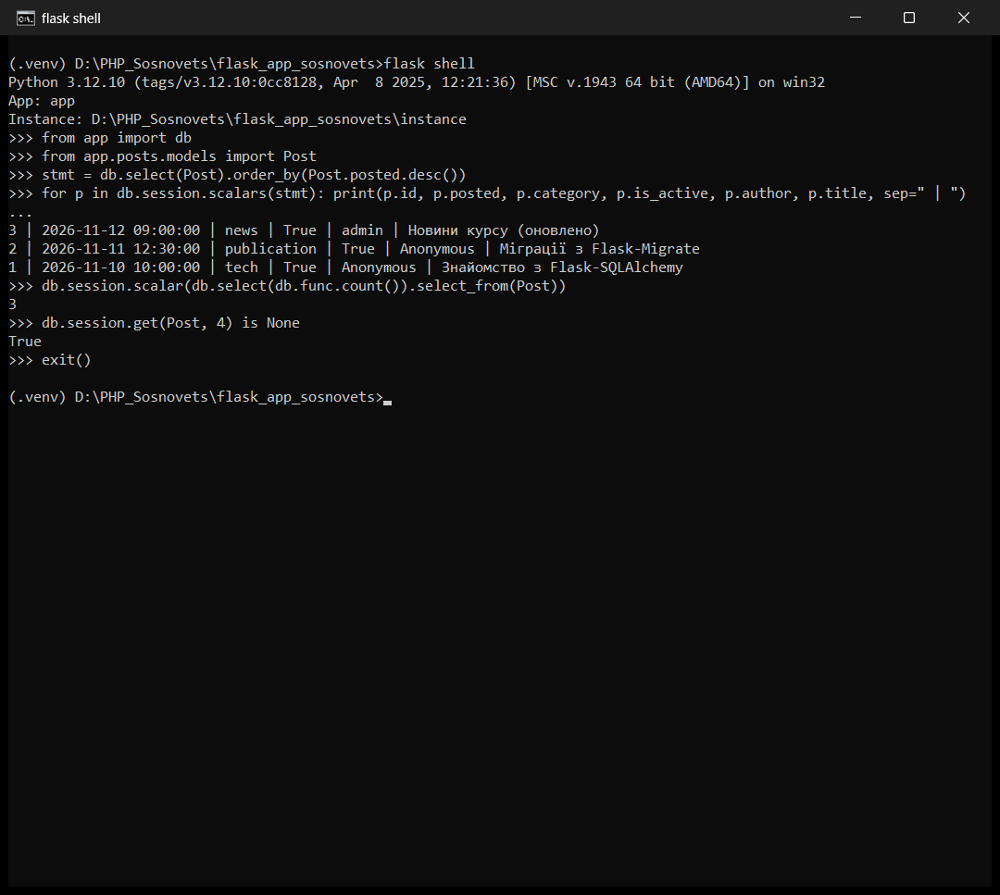

### Модульні тести
**`python -m unittest tests.test_posts -v` — 35 тестів CRUD для постів**

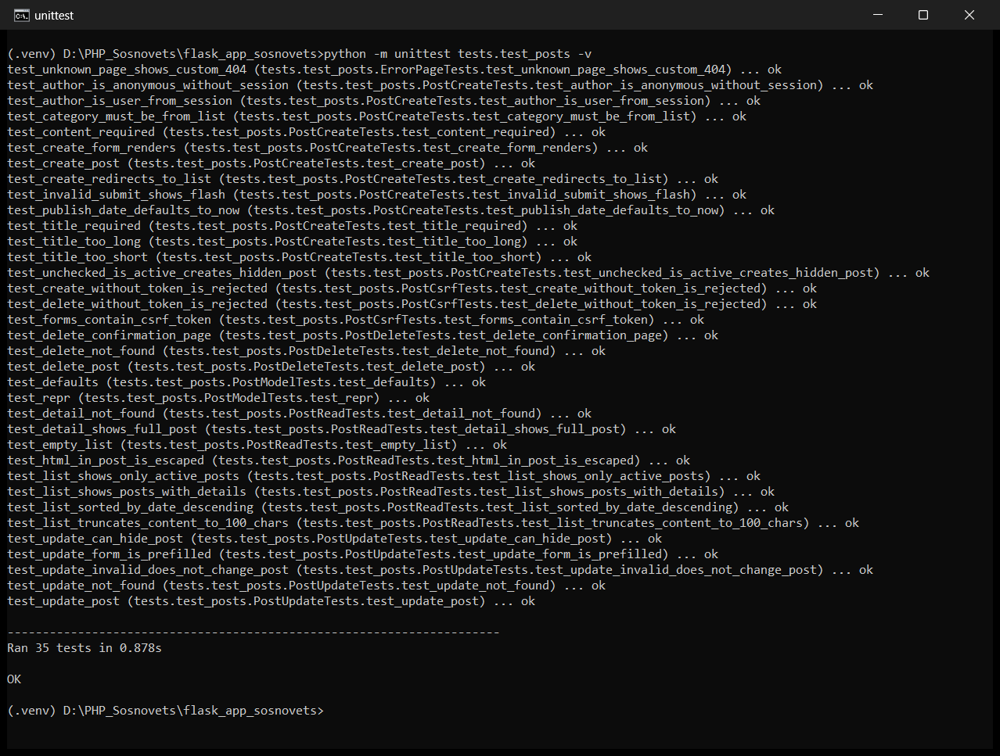

**`python -m unittest discover tests` — усі 124 тести проєкту**

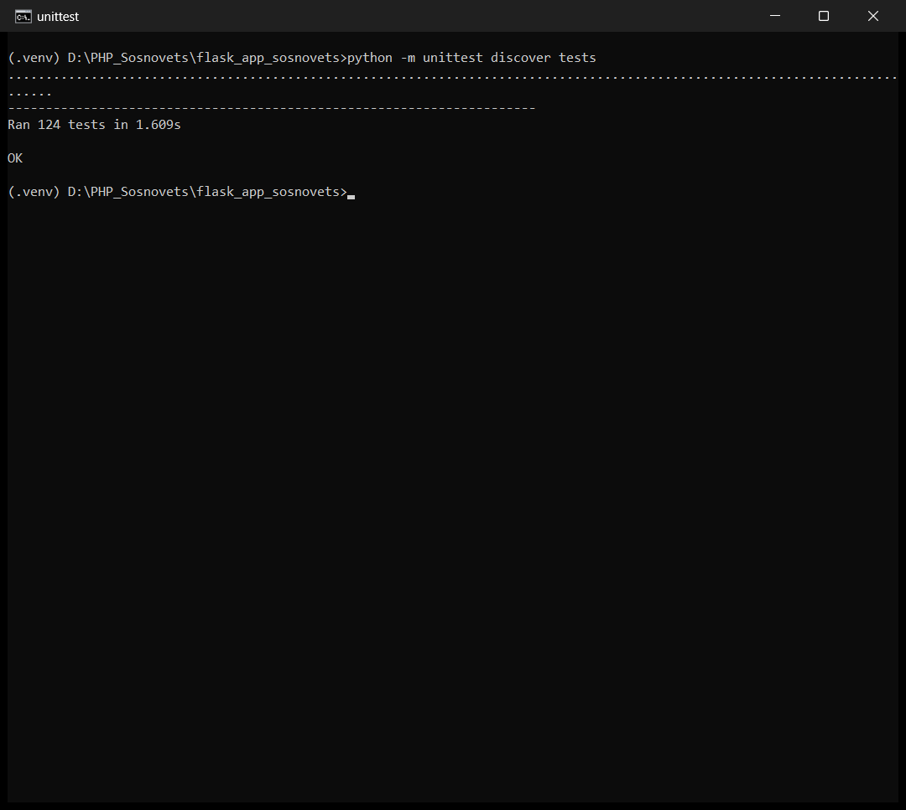
