# Лабораторна робота №8. ORM. Зв'язки між моделями

**Студент:** Сосновець Дмитро Сергійович, ІПЗ-33
**Гілка:** [`lab8`](https://github.com/dmytrososnovets24-glitch/flask-app-lab/tree/lab8) (створена з `lab7`)

## Мета
- Закріпити знання про створення та використання зв'язків між моделями в SQLAlchemy.
- Навчитися працювати з різними типами зв'язків (один-до-багатьох, багато-до-багатьох).
- Ознайомитися з основними операціями над об'єктами, пов'язаними між собою.

## Хід роботи

### 1–2. Модель `User` і міграція
- `app/users/models.py` — модель `User` з полями `id`, `username` (String(20), унікальне), `email` (String(120), унікальне), `password` (String(60)).
- `flask db migrate -m "Add users table"` → `flask db upgrade`: у БД з'явилася таблиця `users` (ревізія `bfcc170b99fa`).

### 3–4. Двосторонній зв'язок `Post` ↔ `User`
- У моделі `Post` видалено поле `author` і додано зовнішній ключ та зв'язок:
  ```python
  user_id: Mapped[int] = mapped_column(ForeignKey("users.id"))
  user: Mapped["User"] = relationship(back_populates="posts")
  ```
- У моделі `User`:
  ```python
  posts: Mapped[list["Post"]] = relationship(back_populates="user", cascade="all, delete-orphan")
  ```
- `flask db migrate -m "Link posts to users, drop author"` → `flask db upgrade` (ревізія `19b6905f12e6`). Завдяки `naming_convention` з лабораторної №7 обмеження отримало ім'я `fk_posts_user_id_users`, тому міграція застосувалась і відкочується без ручних правок.
- У таблиці `posts` уже були пости, а користувачів на момент цієї міграції ще не було, тому стовпець `user_id` спершу додано як NULL (спосіб із лабораторної №7: додати стовпець, заповнити, зробити NOT NULL). Коли всім постам призначено авторів (пункти 6 і 13), міграцією `flask db migrate -m "Posts require an author"` (ревізія `b6b765fd0cc1`) стовпець став `NOT NULL`, тож модель і схема БД збігаються з кодом у завданні (`Mapped[int]`). Пост без автора тепер не зберігається (`IntegrityError: NOT NULL constraint failed: posts.user_id`).

### 5–7. Користувачі та їхні пости у `flask shell`
- Додано двох користувачів: `dmytro` (id=1) і `andrii` (id=2).
- Постам 1 і 3 призначено автора — користувача з id=2.
- `db.session.get(User, 2).posts` повертає пости 1 і 3, `db.session.get(User, 1).posts` — порожній список.

### 8. Вибір автора у формі поста
- `PostForm.author_id = SelectField("Автор", coerce=int)`. Список авторів завантажується в `__init__` форми синтаксисом SQLAlchemy 2.0:
  ```python
  authors = db.session.scalars(db.select(User).order_by(User.id)).all()
  self.author_id.choices = [SelectChoice(a.id, a.username) for a in authors]
  ```
- Валідатор `validate_author_id` перевіряє, що вибраний користувач існує в БД. Під час редагування в списку вибрано поточного автора поста.

### 9. Зв'язок «багато до багатьох» `Post` ↔ `Tag`
- Асоціативна таблиця `post_tags` (`post_id`, `tag_id`, складений первинний ключ) і модель `Tag` (`id`, `name` — унікальне):
  ```python
  post_tags = db.Table(
      'post_tags',
      db.Column('post_id', db.Integer, db.ForeignKey('posts.id'), primary_key=True),
      db.Column('tag_id', db.Integer, db.ForeignKey('tags.id'), primary_key=True),
  )
  # Post
  tags: Mapped[list["Tag"]] = relationship(secondary=post_tags, back_populates="posts")
  # Tag
  posts: Mapped[list["Post"]] = relationship(secondary=post_tags, back_populates="tags")
  ```
- `flask db migrate -m "Add tags and post_tags"` → `flask db upgrade` (ревізія `4961adba1470`).

### 10. Теги у `flask shell`
- Створено теги `Python`, `Flask`, `SQLAlchemy`, `Web` і додано їх до постів через `append()`.
- `p1.tags` — усі теги поста, `flask_tag.posts` — усі пости тегу; у `post_tags` видно відповідні пари `(post_id, tag_id)`.

### 11. Вибір кількох тегів у формі
- `PostForm.tags = SelectMultipleField("Теги", coerce=int)`, варіанти — теги з БД. Вибрані теги зберігаються в `post.tags`; при редагуванні поточні теги поста вже вибрані.

### 12. Теги на сторінці поста
- На сторінці поста теги виводяться окремим блоком у вигляді «пігулок» (`app/posts/static/css/posts.css`, класи `post-tags`, `post-tag`). Кожен тег — посилання на список постів з цим тегом (`/post?tag=Flask`). Теги показано й на картках у списку постів.

### 13. Оптимізація завантаження авторів і тегів
1. Тестові дані: 5 дописів, 2 автори, 4 теги. Допис 1 має три теги, тег `Flask` належить трьом дописам, у кожного допису є автор.
2. Журнал SQL увімкнено параметром конфігурації `SQLALCHEMY_ECHO`, який задається в класі `Config` до ініціалізації розширення (`app/config.py`); у консолі: `set SQLALCHEMY_ECHO=1`.
3. Кожен варіант виконано в окремому запуску `flask shell`. Кількість SELECT рахує обробник події `before_cursor_execute`, підключений безпосередньо перед отриманням дописів, тому враховано лише запити отримання дописів і циклу.

**Варіант 1 — без `.options()`**
```python
from sqlalchemy import select

stmt = select(Post).order_by(Post.id.desc())
posts = db.session.scalars(stmt).all()

for post in posts:
    print(
        post.title,
        post.user.username,
        [tag.name for tag in post.tags],
    )
```

**Варіант 2 — `joinedload()` і `selectinload()`**
```python
from sqlalchemy import select
from sqlalchemy.orm import joinedload, selectinload

stmt = (
    select(Post)
    .options(
        joinedload(Post.user),
        selectinload(Post.tags),
    )
    .order_by(Post.id.desc())
)

posts = db.session.scalars(stmt).all()

for post in posts:
    print(
        post.title,
        post.user.username,
        [tag.name for tag in post.tags],
    )
```

**Результат виконання (однаковий для обох варіантів)**
```
Багато до багатьох: теги постів andrii ['Flask', 'SQLAlchemy', 'Web']
Зв'язок один-до-багатьох у SQLAlchemy dmytro ['Python', 'SQLAlchemy']
Новини курсу (оновлено) andrii []
Міграції з Flask-Migrate dmytro ['Flask']
Знайомство з Flask-SQLAlchemy andrii ['Python', 'Flask', 'SQLAlchemy']
```

**Порівняння**

| Варіант запиту | Кількість дописів | Кількість SELECT |
|---|---|---|
| Без `.options()` | 5 | 8 |
| Із `joinedload()` та `selectinload()` | 5 | 2 |

- Без `.options()`: 1 запит на дописи, 2 запити на авторів і 5 запитів на теги (по одному на кожен допис) — проблема N+1. Авторів лише 2, а не 5, бо вже завантажений користувач береться з identity map сесії і повторно не запитується.
- З `joinedload(Post.user)` автори приходять у тому самому запиті (`LEFT OUTER JOIN users`), а `selectinload(Post.tags)` завантажує теги всіх дописів одним додатковим запитом `... WHERE post_tags.post_id IN (?, ?, ?, ?, ?)`. Разом 2 запити незалежно від кількості дописів.
- Сторінка `/post` використовує другий варіант, тому теж виконує 2 SELECT (це перевіряє тест `test_posts_page_uses_constant_number_of_queries`).

**SQL-журнал** (повністю у [docs/lab8_sql_log_without_options.txt](docs/lab8_sql_log_without_options.txt) і [docs/lab8_sql_log_with_options.txt](docs/lab8_sql_log_with_options.txt))

<details>
<summary>Варіант 1 — 8 SELECT</summary>

```
INFO sqlalchemy.engine.Engine BEGIN (implicit)
INFO sqlalchemy.engine.Engine SELECT posts.id, posts.title, posts.content, posts.posted, posts.category, posts.is_active, posts.user_id
FROM posts ORDER BY posts.id DESC
INFO sqlalchemy.engine.Engine [generated in 0.00017s] ()
INFO sqlalchemy.engine.Engine SELECT users.id, users.username, users.email, users.password
FROM users
WHERE users.id = ?
INFO sqlalchemy.engine.Engine [generated in 0.00057s] (2,)
INFO sqlalchemy.engine.Engine SELECT tags.id, tags.name
FROM tags, post_tags
WHERE ? = post_tags.post_id AND tags.id = post_tags.tag_id
INFO sqlalchemy.engine.Engine [generated in 0.00012s] (5,)
Багато до багатьох: теги постів andrii ['Flask', 'SQLAlchemy', 'Web']
INFO sqlalchemy.engine.Engine SELECT users.id, users.username, users.email, users.password
FROM users
WHERE users.id = ?
INFO sqlalchemy.engine.Engine [cached since 0.002592s ago] (1,)
INFO sqlalchemy.engine.Engine SELECT tags.id, tags.name
FROM tags, post_tags
WHERE ? = post_tags.post_id AND tags.id = post_tags.tag_id
INFO sqlalchemy.engine.Engine [cached since 0.0009378s ago] (4,)
Зв'язок один-до-багатьох у SQLAlchemy dmytro ['Python', 'SQLAlchemy']
INFO sqlalchemy.engine.Engine SELECT tags.id, tags.name
FROM tags, post_tags
WHERE ? = post_tags.post_id AND tags.id = post_tags.tag_id
INFO sqlalchemy.engine.Engine [cached since 0.001296s ago] (3,)
Новини курсу (оновлено) andrii []
INFO sqlalchemy.engine.Engine SELECT tags.id, tags.name
FROM tags, post_tags
WHERE ? = post_tags.post_id AND tags.id = post_tags.tag_id
INFO sqlalchemy.engine.Engine [cached since 0.001624s ago] (2,)
Міграції з Flask-Migrate dmytro ['Flask']
INFO sqlalchemy.engine.Engine SELECT tags.id, tags.name
FROM tags, post_tags
WHERE ? = post_tags.post_id AND tags.id = post_tags.tag_id
INFO sqlalchemy.engine.Engine [cached since 0.001958s ago] (1,)
Знайомство з Flask-SQLAlchemy andrii ['Python', 'Flask', 'SQLAlchemy']
Кількість дописів: 5 | Кількість SELECT: 8
```
</details>

<details>
<summary>Варіант 2 — 2 SELECT</summary>

```
INFO sqlalchemy.engine.Engine BEGIN (implicit)
INFO sqlalchemy.engine.Engine SELECT posts.id, posts.title, posts.content, posts.posted, posts.category, posts.is_active, posts.user_id, users_1.id AS id_1, users_1.username, users_1.email, users_1.password
FROM posts LEFT OUTER JOIN users AS users_1 ON users_1.id = posts.user_id ORDER BY posts.id DESC
INFO sqlalchemy.engine.Engine [generated in 0.00016s] ()
INFO sqlalchemy.engine.Engine SELECT post_tags.post_id, tags.id, tags.name
FROM post_tags JOIN tags ON tags.id = post_tags.tag_id
WHERE post_tags.post_id IN (?, ?, ?, ?, ?)
INFO sqlalchemy.engine.Engine [generated in 0.00065s] (5, 4, 3, 2, 1)
Багато до багатьох: теги постів andrii ['Flask', 'SQLAlchemy', 'Web']
Зв'язок один-до-багатьох у SQLAlchemy dmytro ['Python', 'SQLAlchemy']
Новини курсу (оновлено) andrii []
Міграції з Flask-Migrate dmytro ['Flask']
Знайомство з Flask-SQLAlchemy andrii ['Python', 'Flask', 'SQLAlchemy']
Кількість дописів: 5 | Кількість SELECT: 2
```
</details>

## Нові міграції
| Ревізія | Повідомлення | Що робить |
|---|---|---|
| `bfcc170b99fa` | Add users table | таблиця `users` |
| `19b6905f12e6` | Link posts to users, drop author | `posts.user_id` + `fk_posts_user_id_users`, видалення `posts.author` |
| `4961adba1470` | Add tags and post_tags | таблиці `tags` і `post_tags` |
| `b6b765fd0cc1` | Posts require an author | `posts.user_id` стає `NOT NULL` (коли всі пости вже мають авторів) |

## Скриншоти

### Пункти 2–4. Таблиці `users` і `posts` після міграцій
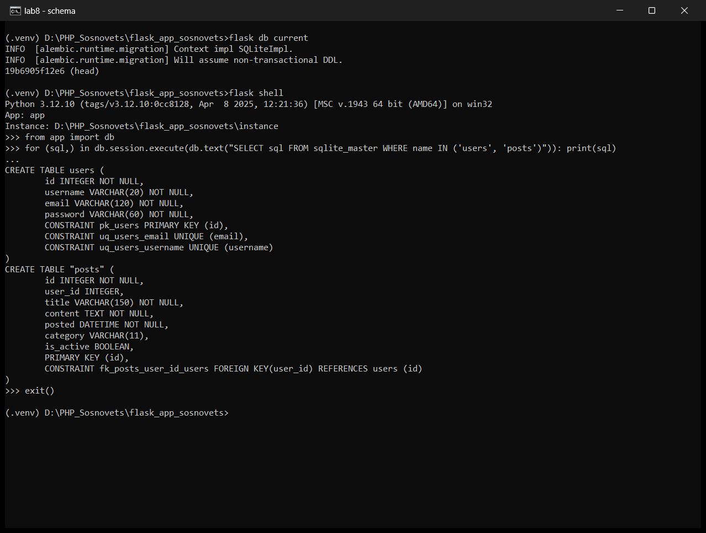

### Пункти 5–7. Користувачі, призначення автора, пости користувачів з id=2 і id=1
На цьому етапі пост 2 ще без автора; пізніше автора отримали всі пости, і `user_id` став обов'язковим (див. нижче).

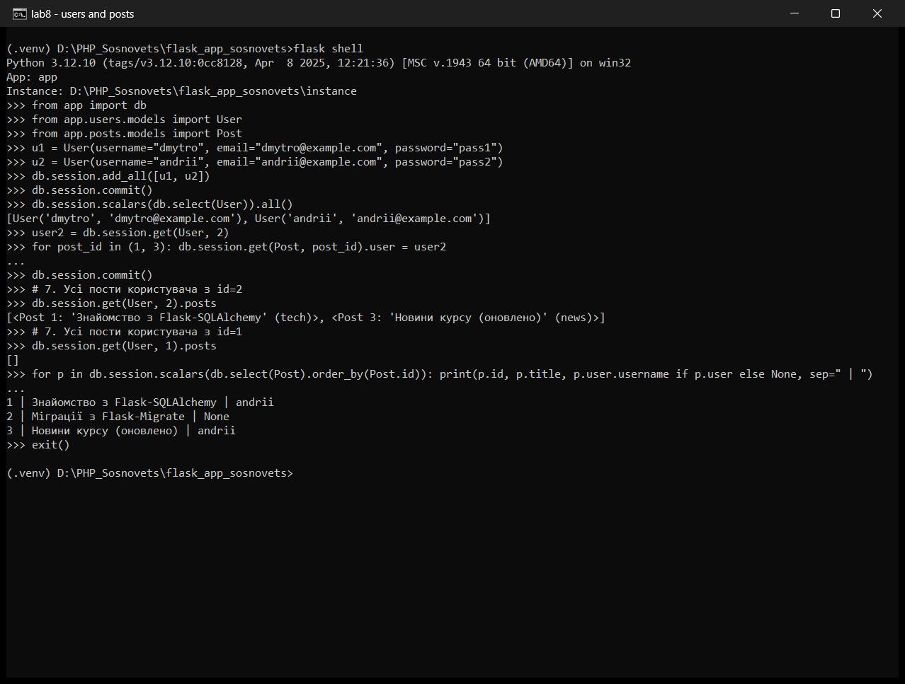

### Пункт 8. Список авторів із БД у формі нового поста
Для скріншота список «Автор» показано розгорнутим: у ньому обидва користувачі з таблиці `users`.

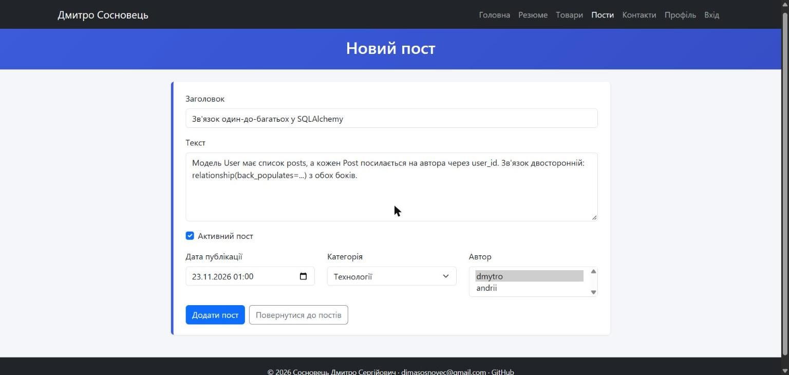

**Після збереження: пост з автором `dmytro` у списку**

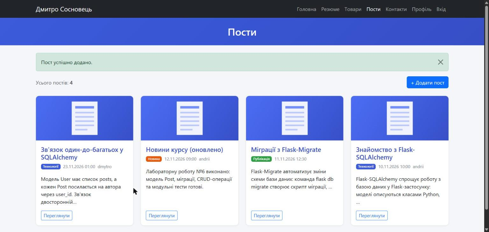

### Пункт 9. Міграція для `tags` і `post_tags`
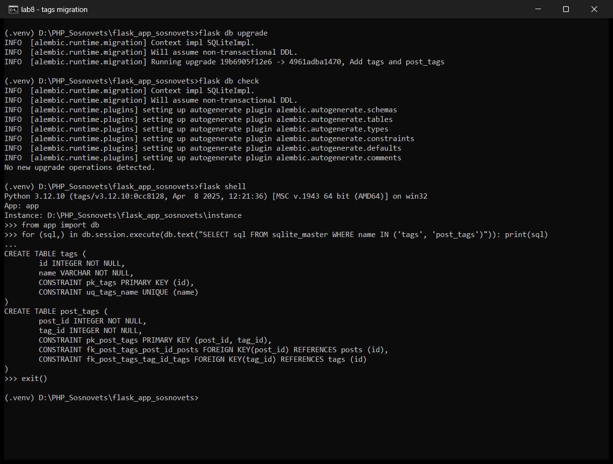

### Пункт 10. Теги у `flask shell`: `append()`, теги поста, пости тегу
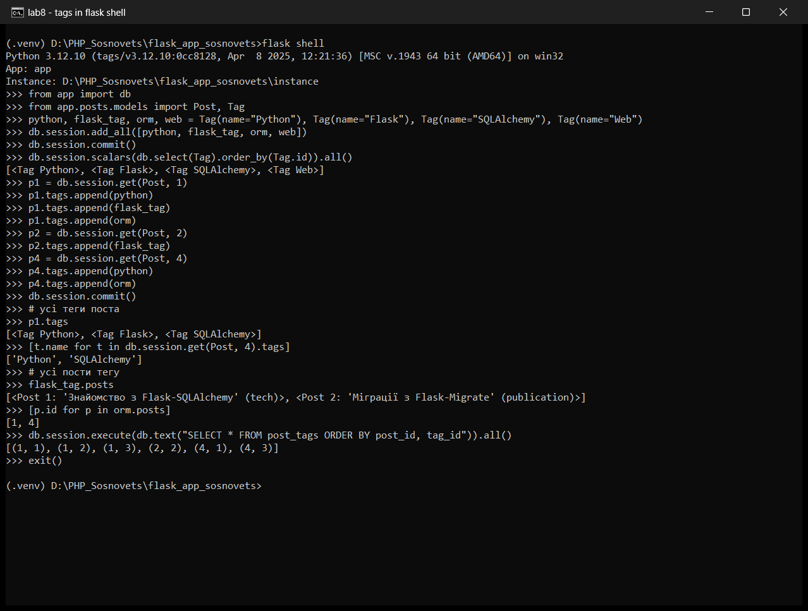

### Пункт 11. Вибір кількох тегів у формі нового поста
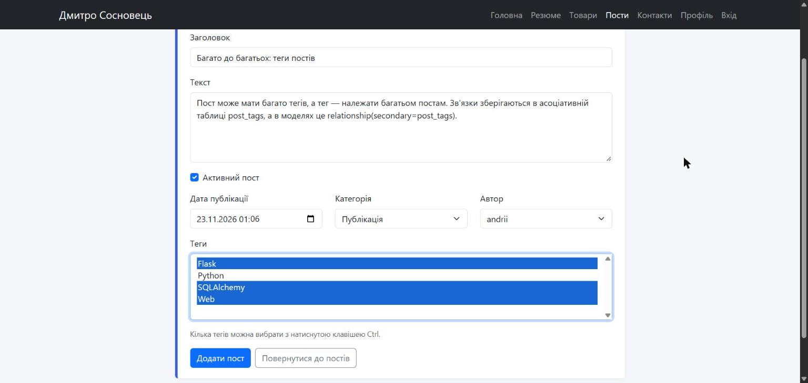

**Після збереження: теги на картці поста**

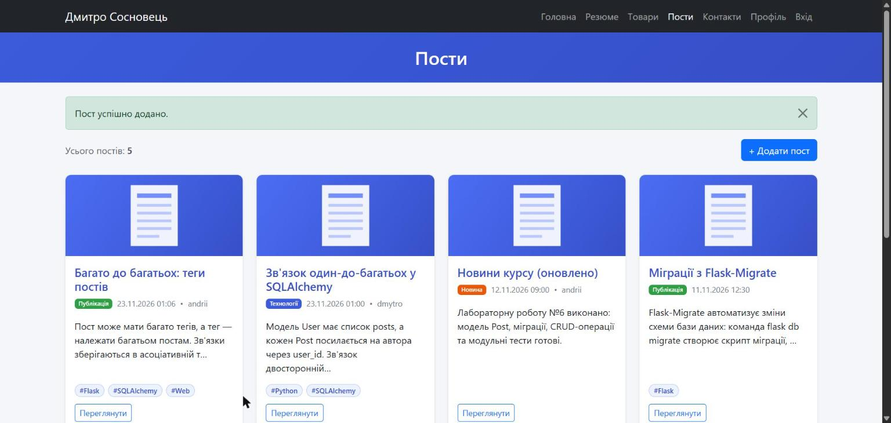

### Пункт 12. Стилізовані теги на сторінці поста
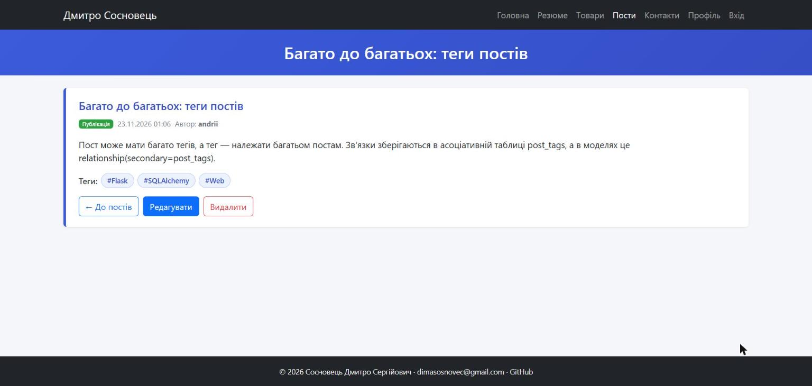

**Перехід за тегом: пости з тегом `SQLAlchemy`**

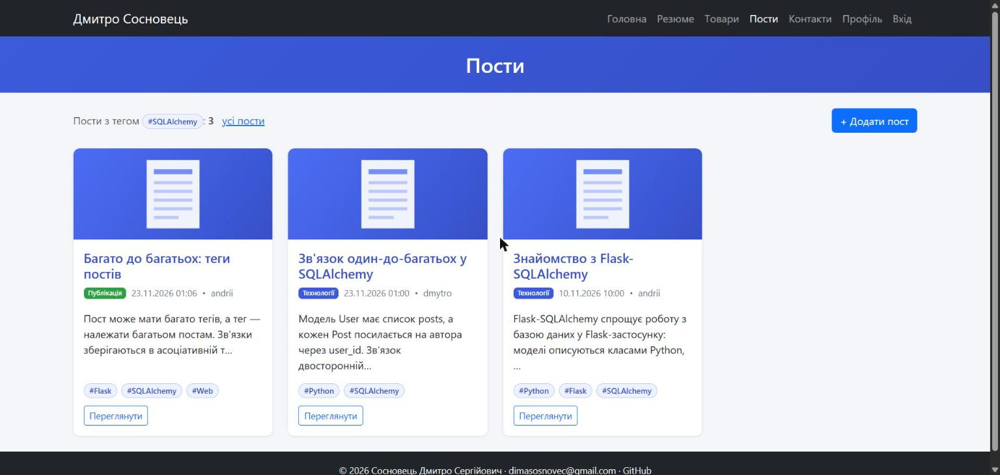

### Пункт 13. Оптимізація завантаження
**Тестові дані: кожен допис має автора, допис 1 має кілька тегів, тег `Flask` — у кількох дописах**

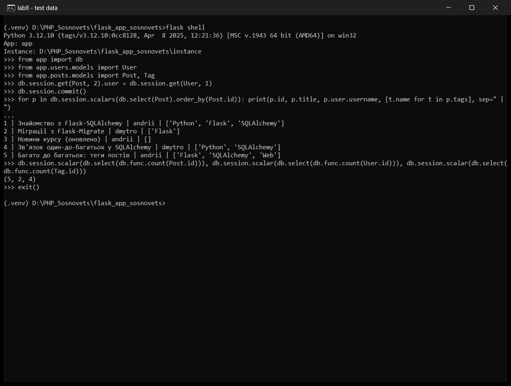

**Варіант 1, без `.options()`: отримання дописів (1 SELECT)**

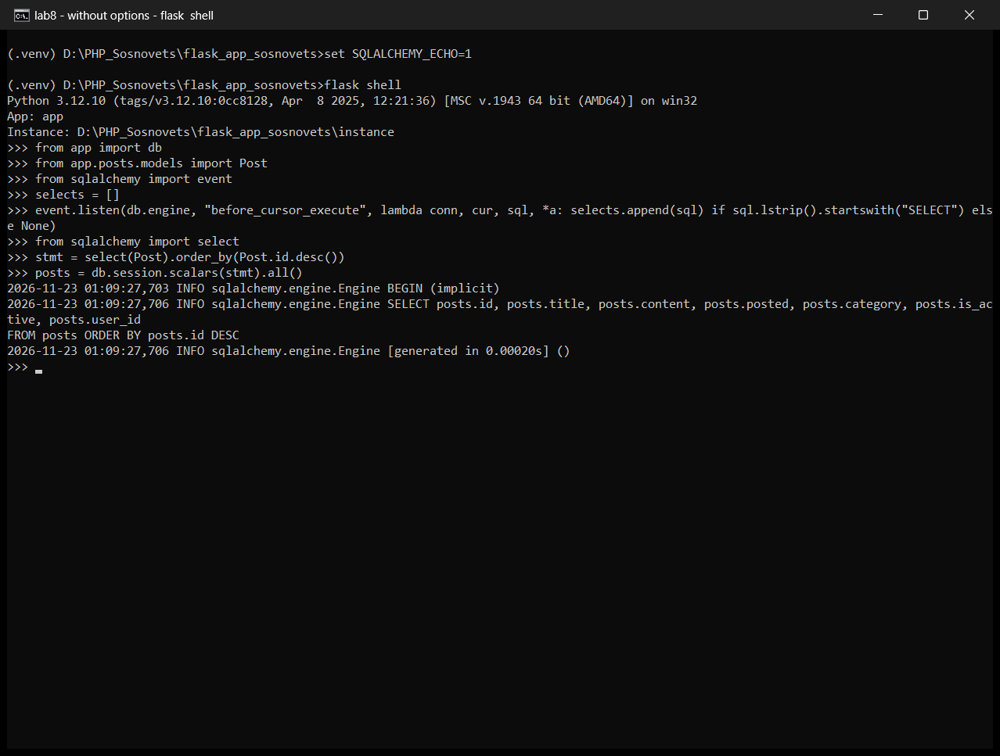

**Варіант 1, без `.options()`: цикл виконує додаткові SELECT, разом 8**

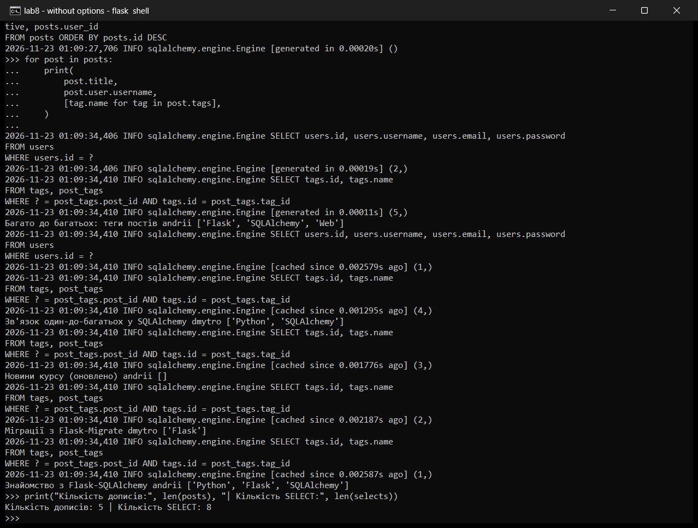

**Варіант 2, `joinedload()` і `selectinload()`: 2 SELECT (окремий запуск `flask shell`)**

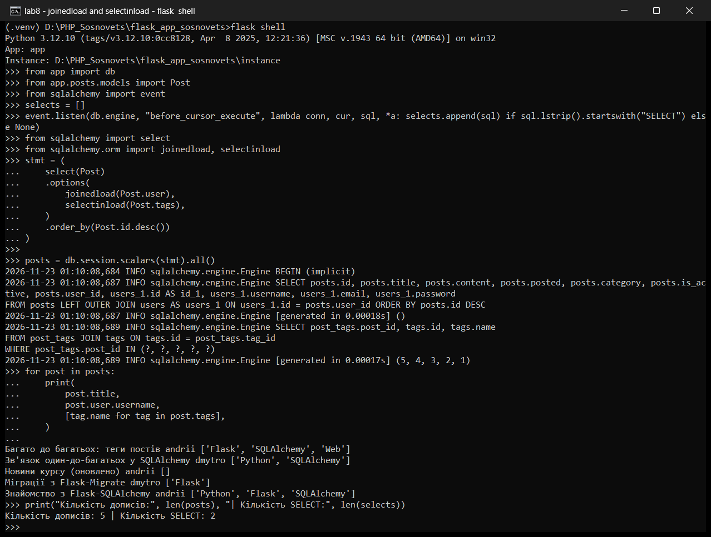

### Обов'язковий автор поста
**Після міграції `b6b765fd0cc1`: `user_id INTEGER NOT NULL`, пост без автора відхиляється, історія міграцій**

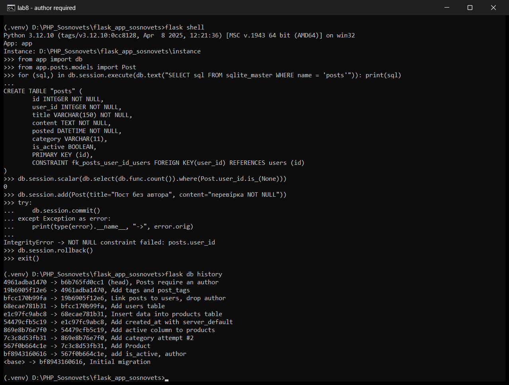

### Тести
**`python -m unittest tests.test_relations -v` і `python -m unittest discover tests` — 176 тестів, усі проходять**

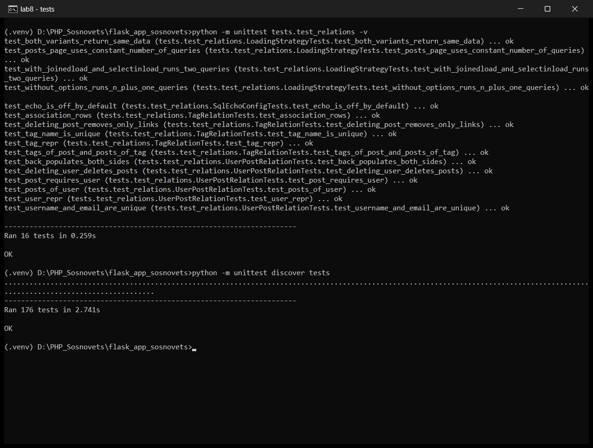

## Тести
- `tests/test_relations.py` — 16 тестів: зв'язок `User.posts` ↔ `Post.user` (зокрема каскадне видалення і заборона поста без автора), зв'язок `Post.tags` ↔ `Tag.posts` і рядки `post_tags`, унікальність `username`, `email`, `name`, кількість SELECT в обох варіантах пункту 13 і на сторінці `/post`.
- `tests/test_posts.py` доповнено перевірками вибору автора, вибору тегів, виводу тегів і фільтра за тегом.
- Усього 176 тестів, усі проходять. Повний вивід: [docs/test_results.txt](docs/test_results.txt).

## Запуск
```bash
python -m venv .venv
.venv\Scripts\activate
pip install -r requirements.txt
copy .env.example .env
flask db upgrade
flask run                                  # http://127.0.0.1:8080
python -m unittest discover tests -v
```
