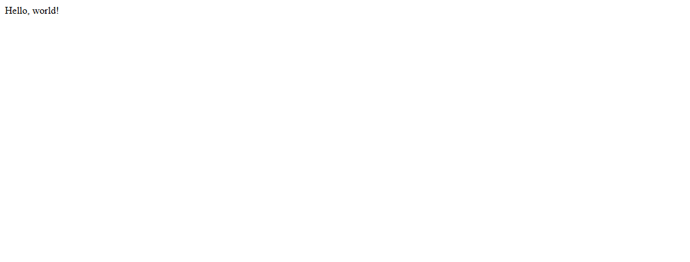
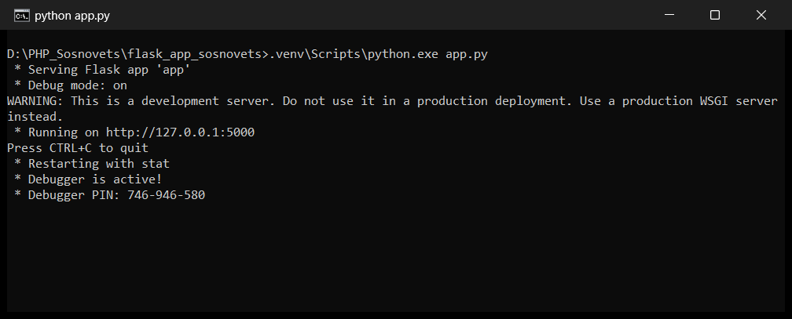
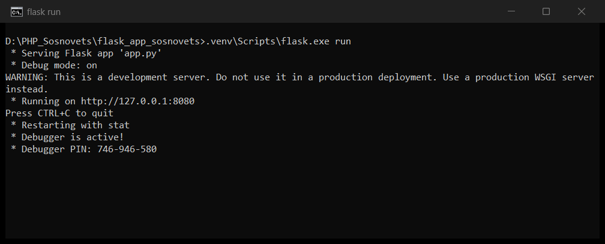
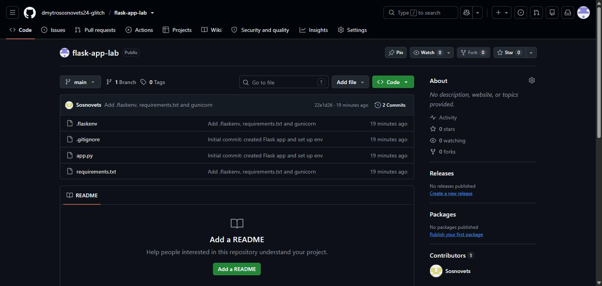
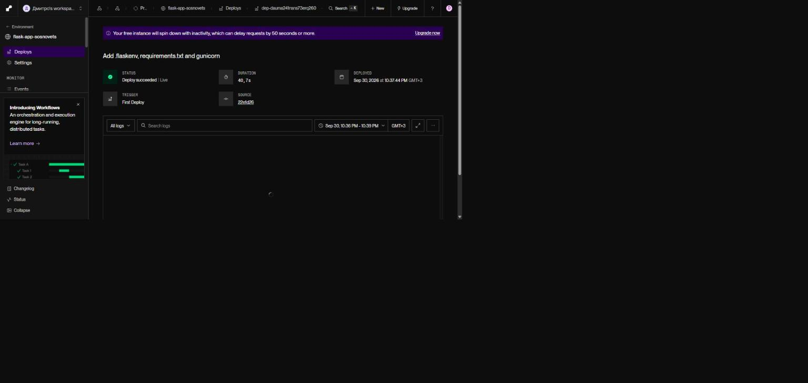
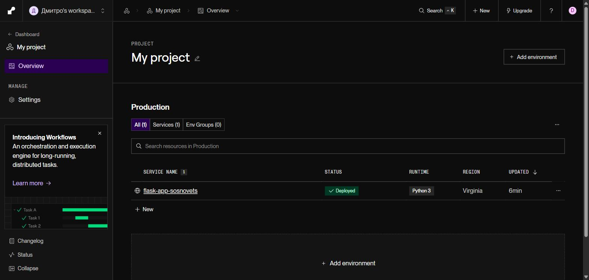
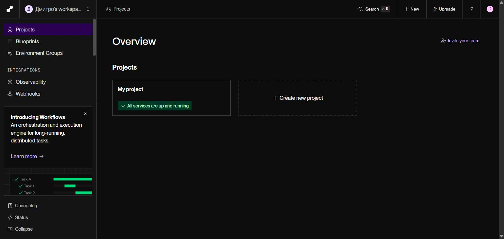
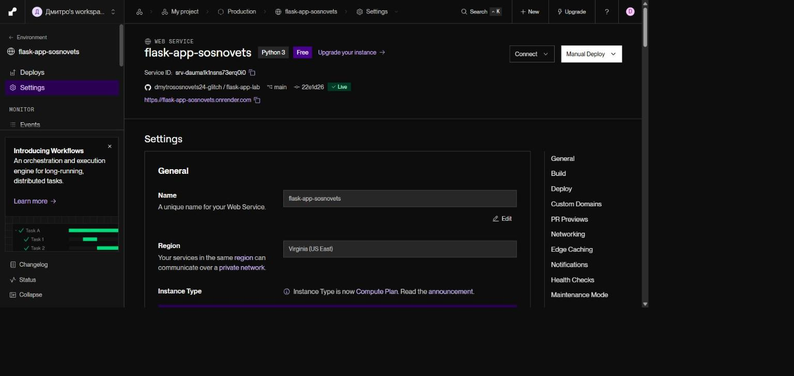
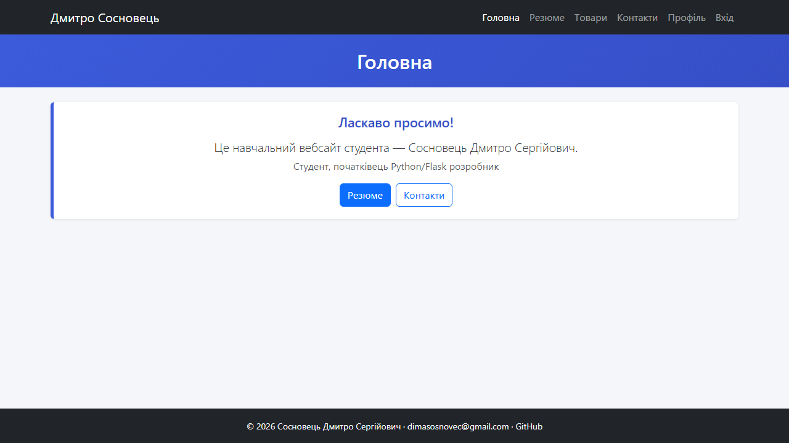

# Лабораторна робота №1. Найпростіший Flask-додаток

**Студент:** Сосновець Дмитро Сергійович, ІПЗ-33

- Код цієї лабораторної: гілка [`lab1`](https://github.com/dmytrososnovets24-glitch/flask-app-lab/tree/lab1)
- Репозиторій проєкту: https://github.com/dmytrososnovets24-glitch/flask-app-lab
- Розгорнутий застосунок на Render: https://flask-app-sosnovets.onrender.com/

## Хід роботи

### Частина 1. Базовий Flask-додаток із віртуальним середовищем
1. Створено каталог проєкту `flask_app_sosnovets`, у ньому віртуальне середовище `.venv`.
2. Оновлено `pip`, встановлено Flask (`pip install flask`, версія 3.0.3).
3. Ініціалізовано Git-репозиторій; `.gitignore` виключає віртуальне середовище.
4. Створено `app.py`:
   ```python
   from flask import Flask
   app = Flask(__name__)

   @app.route('/')
   def main():
       return 'Hello, world!'

   if __name__ == '__main__':
       app.run(debug=True)
   ```
5. Додаток запущено командою `python app.py` (порт 5000) і перевірено у браузері.
6. Встановлено `python-dotenv`, створено `.flaskenv`:
   ```
   FLASK_DEBUG=1
   FLASK_APP=app.py
   FLASK_RUN_PORT=8080
   ```
   Після цього `flask run` запускає сервер у режимі debug на порту 8080.
7. Створено `requirements.txt`, зроблено коміти, проєкт завантажено в репозиторій `flask-app-lab` на GitHub.

### Частина 2. Розгортання на Render
1. До проєкту додано app-сервер `gunicorn` (є в `requirements.txt`).
2. На Render.com створено веб-сервіс із репозиторію: Build Command `pip install -r requirements.txt`, Start Command `gunicorn app:app`, тариф Free.
3. Після деплою сервіс доступний за адресою https://flask-app-sosnovets.onrender.com/.

## Скриншоти

**1. Сторінка у браузері (локальний запуск, `http://127.0.0.1:5000/`)**



**2. Запуск командою `python app.py` (Debug mode: on, порт 5000)**



**3. Запуск командою `flask run` з налаштуваннями `.flaskenv` (Debug mode: on, порт 8080)**



**4. Репозиторій на GitHub**



**5. Розгортання на Render завершено (Deploy succeeded, Live)**



**6. Дашборд у профілі Render: сервіс `flask-app-sosnovets`, статус Deployed**



**7. Дашборд у профілі Render: огляд проєкту**



**8. Налаштування веб-сервісу на Render (Python 3, Free, адреса сервісу)**



**9. Перевірка розгорнутого застосунку у браузері (https://flask-app-sosnovets.onrender.com/)**

Сервіс на Render автоматично оновлюється з гілки `main`, тому зараз на ньому актуальна версія проєкту (з наступними лабораторними).


