# Лабораторна робота №5. WTF-форми

**Студент:** Сосновець Дмитро Сергійович, ІПЗ-33
**Гілка:** `lab5` (створена з `lab4`) · **Сайт:** https://flask-app-sosnovets.onrender.com/

## Завдання 1. Контактна форма на Flask-WTF
- Клас `ContactForm` у окремому модулі `app/forms.py`: `name` (4–10 символів), `email`, `phone` (`+380XXXXXXXXX`), `subject` (випадаючий список), `message` (до 500 символів), кнопка відправки.
- Валідація полів і захист від CSRF; поля виводяться макросом `render_field` (`app/templates/macros/forms.html`) разом із блоком помилок.
- flash-повідомлення з категоріями; дані форми дописуються в лог-файл `logs/contact_messages.log` (модуль `logging`), про успіх/збій запису користувач бачить flash.
- Post/Redirect/Get: після обробки форми виконується редірект.

## Завдання 2. Блюпринт `products` на TinyDB + Flask-WTF
- Сховище: `data/products.json` (TinyDB), автоматичні `id` і `created_at`; початкові товари створюються при першому запуску.
- Поля товару: `id`, `name` (≥3 символи), `content` (textarea 5×40), `price` (>0, не більше 2 знаків після коми), `category` (зі списку), `quantity` (≥0), `image`, `created_at`.
- CRUD: `/product/` (список), `/product/<id>` (товар, обробка 404), `/product/add`, `/product/<id>/edit`, `/product/<id>/delete` (POST, підтвердження, CSRF).
- Зображення: PNG/JPG/JPEG, ліміт 2 МБ, перевірка вмісту, ім'я файлу — UUID, збереження в `app/products/static/uploads/`, шлях у TinyDB, заглушка за відсутності фото; при заміні/видаленні старий файл видаляється.
- **Тести:** 89 (`unittest`) — контактна форма, повний CRUD, валідація, зображення, CSRF.

## Структура (нове в цій лабі)
```
app/forms.py, app/contact_log.py
app/templates/macros/forms.html, app/templates/404.html
app/products/ storage.py (TinyDB), forms.py, views.py, static/uploads/, templates/products/{products,detail_product,product_form}.html
tests/ test_contact_form.py, test_products_bp.py
```

## Запуск і тести
```bash
pip install -r requirements.txt
flask run                                  # http://127.0.0.1:8080
python -m unittest discover tests -v       # Ran 89 tests ... OK
```
Результат тестів: [docs/test_results.txt](docs/test_results.txt) · приклад рядка логу: [docs/contact_messages_example.log](docs/contact_messages_example.log)

## Скриншоти
### Завдання 1. Контактна форма
**Порожня форма**
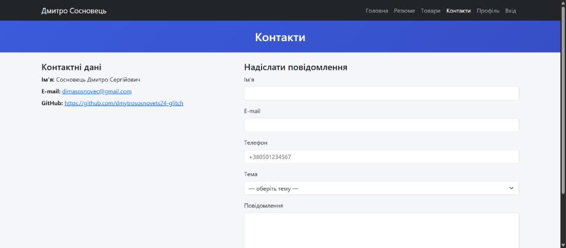

**Помилки валідації**
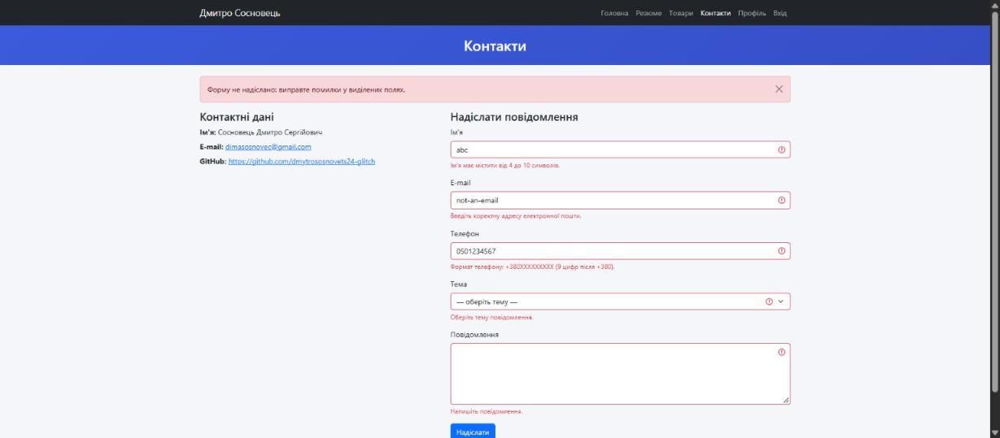

**Успішна відправка (PRG + flash)**
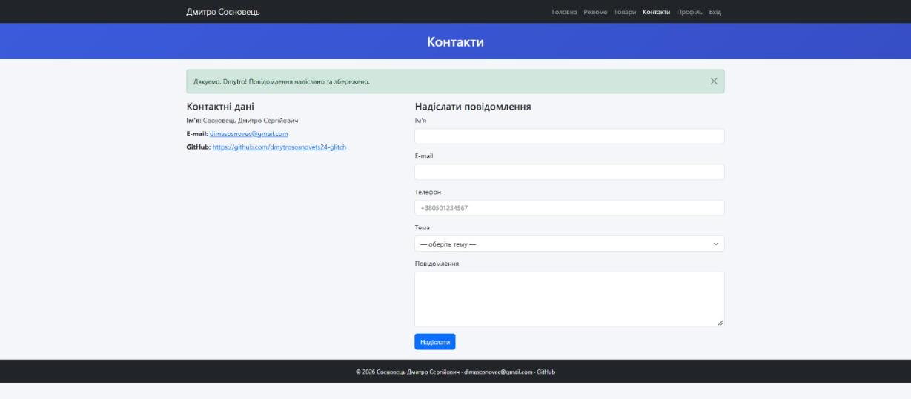

### Завдання 2. Товари
**Список товарів**
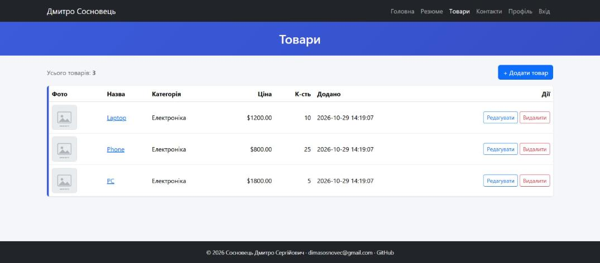

**Додавання: помилки валідації**
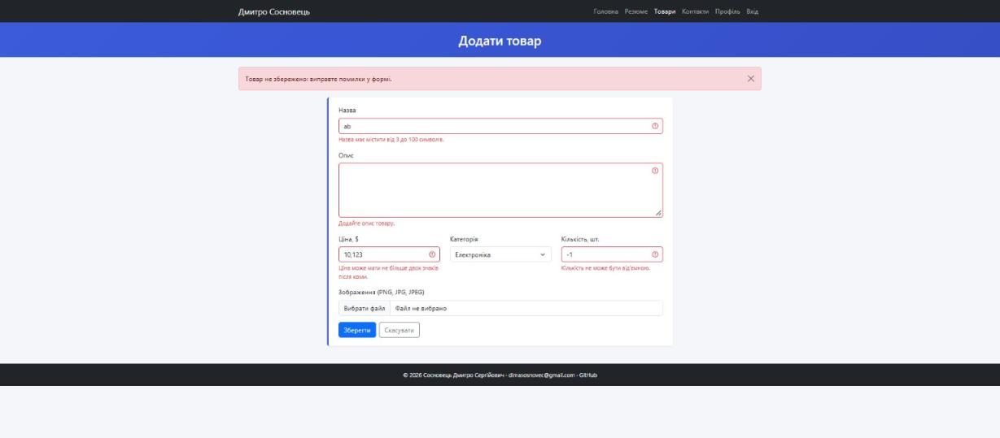

**Додавання: заповнена форма із зображенням**
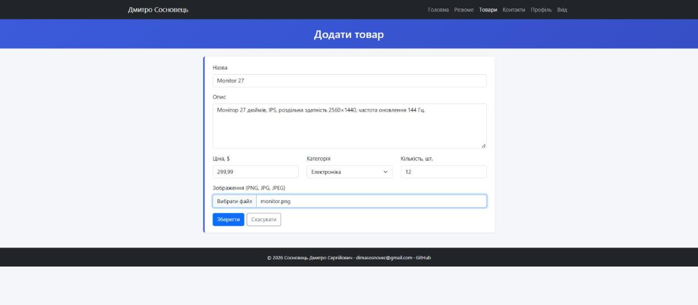

**Сторінка товару після додавання (PRG + flash)**
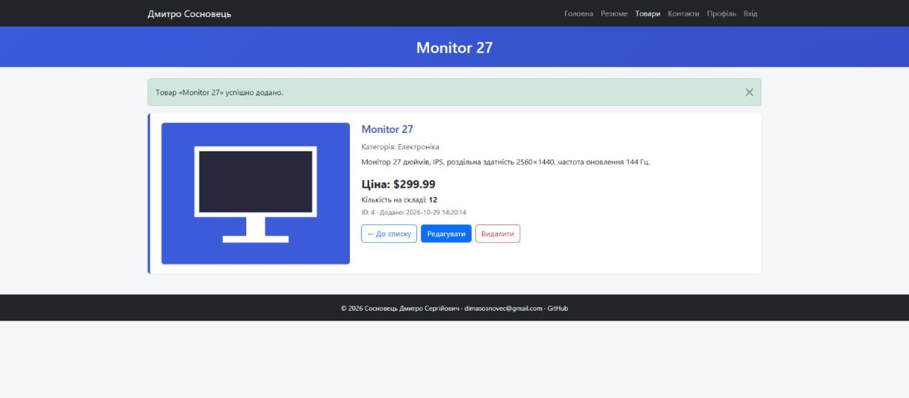

**Редагування: форма з поточними даними**
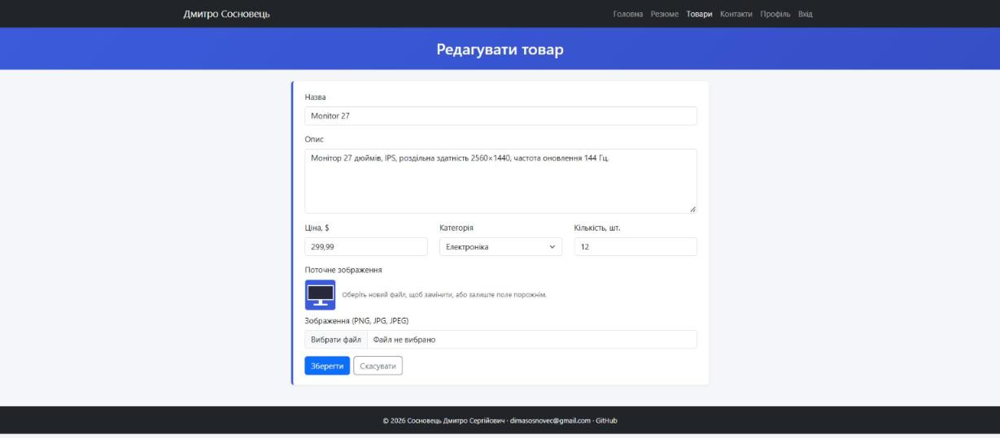

**Після редагування (нове зображення, id і дата збережені)**
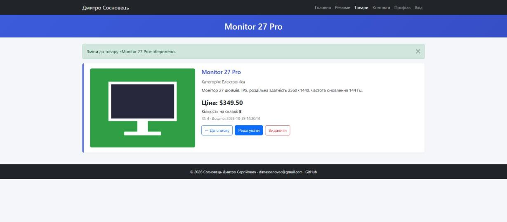

**Список із фото товару**
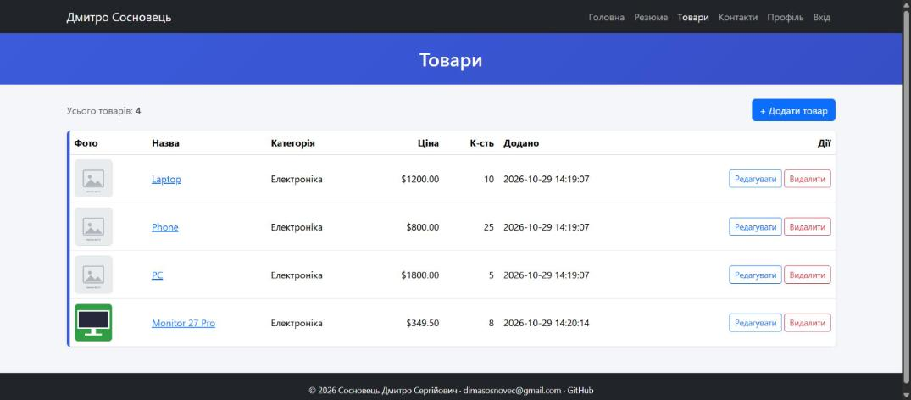

**Після видалення**
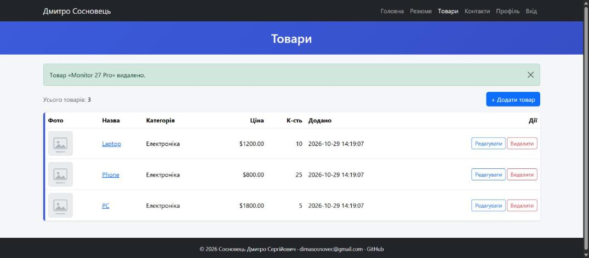

**Товар не знайдено (404)**
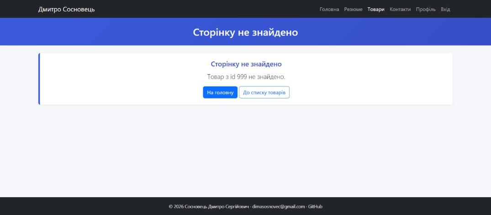

**Розгорнутий сайт на Render**
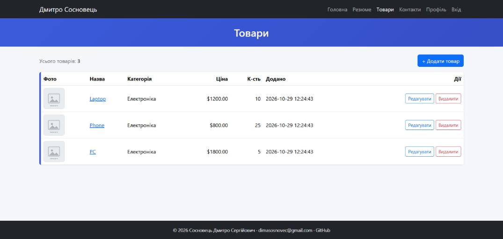
